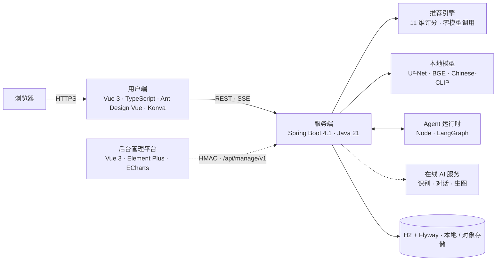

> 本文是**第九届传智杯 · AI WEB 网页开发挑战赛**的参赛说明，只服务于评审。项目本身的介绍、运行与开发文档见 [README.md](README.md)，用户端见 [smart-closet](https://github.com/yumengjh/smart-closet)。

# 鱼搭 · AI 数字衣柜

**第九届传智杯全国大学生数智创新与 AI 应用大赛 · AI WEB 网页开发挑战赛 参赛作品**

团队：鱼力无限

## 作品一句话

拍一张照片入柜，打开就知道今天穿什么。推荐由可解释的代码算出，大模型只用来理解语言、识别图片和生成效果图。

> 本仓库是供评审查看的**裁剪副本**：核心代码与相关历史已移除，不能直接构建，清单见 [REVIEW_COPY.md](REVIEW_COPY.md)。完整功能请使用在线演示或便携版。

## 评审快速入口

| 想看什么 | 去哪里 |
|:--|:--|
| 在线体验 | 用户端：【待填写：用户端线上地址】；后台管理平台：【待填写：后台线上地址】 |
| 评审体验账号 | 用户名：【待填写】；密码：见提交页说明（不写入仓库） |
| 项目介绍与界面截图 | [README.md](README.md) |
| 技术文档（PDF） | 随作品通过大赛官网提交 |
| 演示视频 | 随作品通过大赛官网提交 |
| 离线试用（不用联网、不用装软件） | [便携版](README.md#便携版一键启动)，五个平台解压即用 |
| 完整设计与报告 | [docs/README.md](docs/README.md) |

## 技术架构

更完整的组件说明见 [README.md 的架构一节](README.md#架构)。

## AI 技术怎么用的

先问每个环节是否真的需要大模型：能用规则和本地模型稳定算出来的就不交给远程模型。

| 环节 | 是否调用远程大模型 | 技术 |
|:--|:--|:--|
| 召回、组合、打分、换一批、换一件、搜索、取色 | 否 | Java 规则引擎，11 维评分，审美规则与 18 个中文风格画像 |
| 语义搜索、相似衣物、以图搜图 | 否（本地模型） | BGE 文本向量，Chinese-CLIP 图文模型，ONNX Runtime |
| 抠图与颜色测量 | 否（本地模型） | U²-Net，OpenCV GrabCut，CIELAB |
| 图片识别入柜 | 是 | 多模态大模型，输出经契约校验，字段区分已确认、推测、未知、冲突 |
| 聊天与全局助手 | 是 | LangGraph 智能体，工具白名单，每轮短期授权，SSE 流式 |
| 个人 OOTD 效果图 | 是 | 图像生成模型，需用户确认，结果未知不自动重发 |

关于评审标准里的几项，如实说明：

- **RAG**：没有采用“检索文档再交给模型生成”的做法。检索放在代码侧：本地向量语义检索加已审核的搭法模板填位，结果不再交给大模型改写。
- **MCP**：没有使用 MCP 协议，助手通过受限的内部工具接口调用后端能力，Node 进程不直连数据库。
- **AI 安全与可控**：不向模型发送衣物完整资料、性别、身材；整套穿搭样本疑似未成年自动拒收；生成须用户确认；每账号每日 AI 额度。

详细的选型理由、集成方式与优化策略见技术文档第四章。

## 运行方式

| 方式 | 步骤 |
|:--|:--|
| 在线体验 | 使用上方的线上地址与评审账号 |
| 便携版 | 下载对应平台压缩包，解压后双击 `start.bat` / `start.command` / `./start.sh`，菜单输入 1，浏览器自动打开 |
| 源码 | 见 [README.md 源码运行](README.md#源码运行开发)；用户端另需检出 [smart-closet](https://github.com/yumengjh/smart-closet) 到相邻目录 |
| 容器 | 见 [README.md 容器部署](README.md#容器部署) |

环境变量模板：[.env.example](.env.example)；在线 AI 服务的配置示例：[docs/generation.example.yml](docs/generation.example.yml)。**真实密钥不在仓库中**，只通过环境变量或被 Git 忽略的 `.local/` 配置。不配置在线 AI 服务时，入柜、抠图、搜索、推荐、画板等本地功能照常可用。

## 仓库与开发过程

| 仓库 | 内容 | 提交数 | 起始 |
|:--|:--|--:|:--|
| [smart-closet-server](https://github.com/yumengjh/smart-closet-server) | 服务端与 Agent 运行时 | 211 | 2026-09-27 |
| [smart-closet](https://github.com/yumengjh/smart-closet) | 用户端 | 105 | 2026-09-30 |

保留完整的 Git 提交历史（截至 2026-10-21），每个功能有设计文档，改动按 Pull Request 合并。设计文档在 [docs/design/](docs/design/)，实验与验收报告在 [docs/reports/](docs/reports/)。

## 测试

后端 596 项、用户端 107 项自动化测试；推荐质量由“好坏搭配考试题”、审美规则完备性和曝光均衡等测试守护。命令见 [README.md 测试一节](README.md#测试)。

## 许可与使用范围

本项目是独立开发、计划商业化运营的 SaaS 产品，**不是开源软件**。仓库对评审开放，仅用于核验项目真实性与 AI 协同开发过程。评审人员可以阅读源码与提交历史，并在自己的设备上临时克隆、构建、运行和测试；不得复制传播、修改、二次开发、商业使用或用于训练 AI 模型。完整条款见 [LICENSE](LICENSE)。

## 原创性与第三方组件

作品为团队原创。使用的开源技术包括 Spring Boot、MyBatis-Plus、Flyway、H2、ONNX Runtime、OpenCV、LangGraph.js、Vue 3、Ant Design Vue、Konva 等，以及公开的预训练模型 U²-Net、BGE、Chinese-CLIP；模型来源、许可证与校验见 [models/README.md](models/README.md)。项目的贡献在于领域规则与算法组合、反馈机制、人机协作执行和工程闭环，而不是训练新的基础模型。

## 团队

| 角色 | 姓名 | 学校 / 组别 |
|:--|:--|:--|
| 团队成员 | 姚品鑫、张榆晓 | 广东科贸职业学院（参赛组别以报名为准） |
| 指导教师 | 凡飞飞、李观金 | 广东科贸职业学院 |
