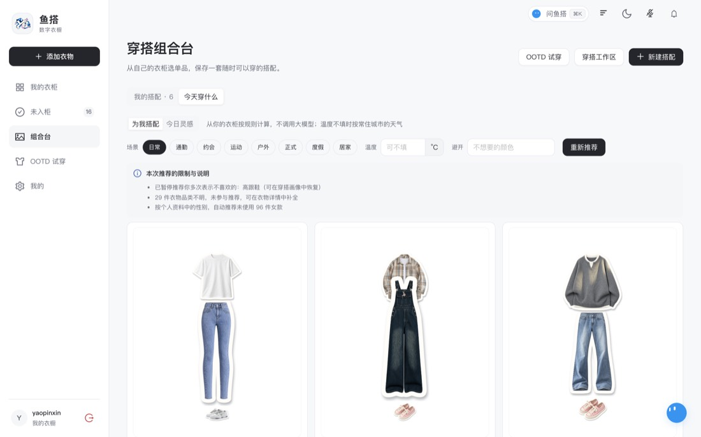
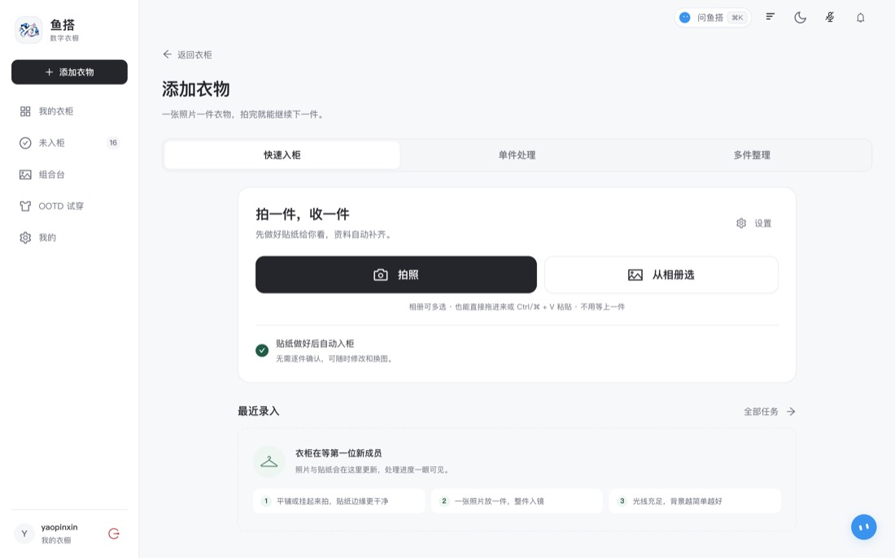
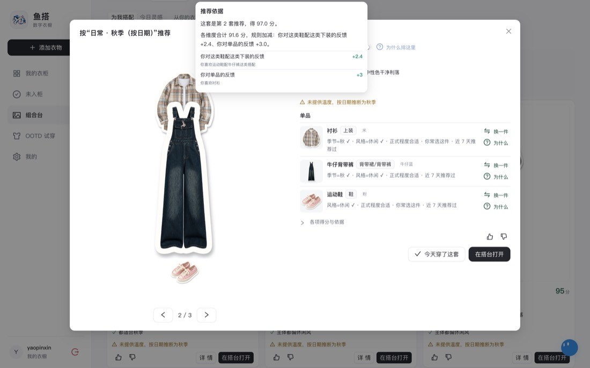
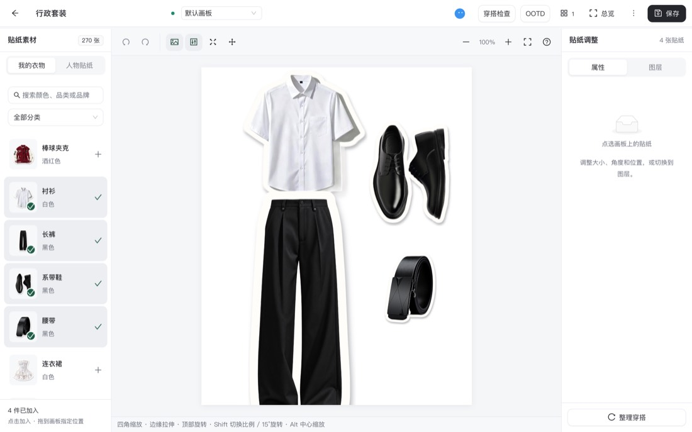
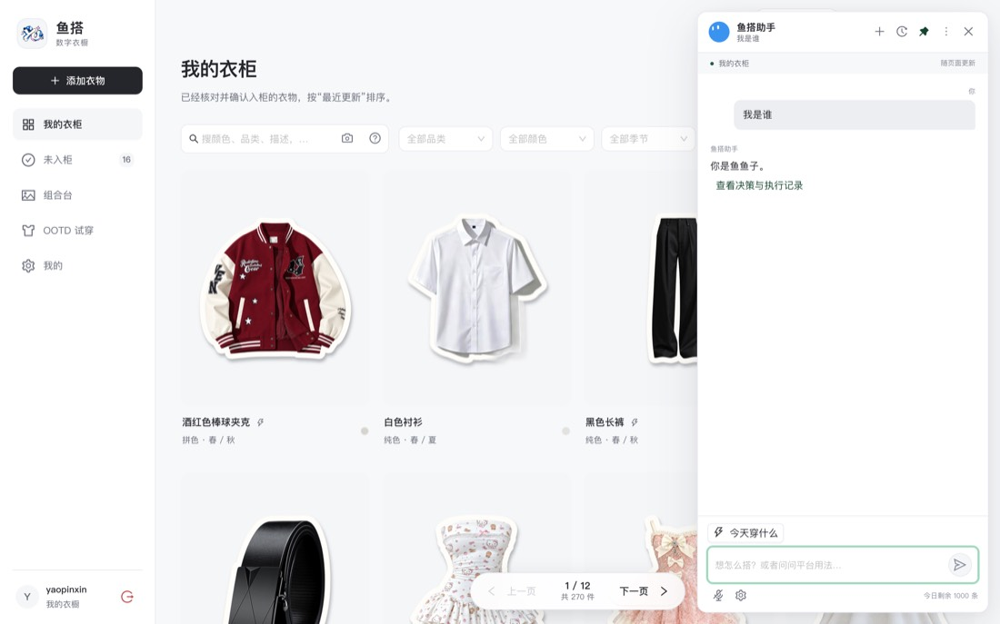
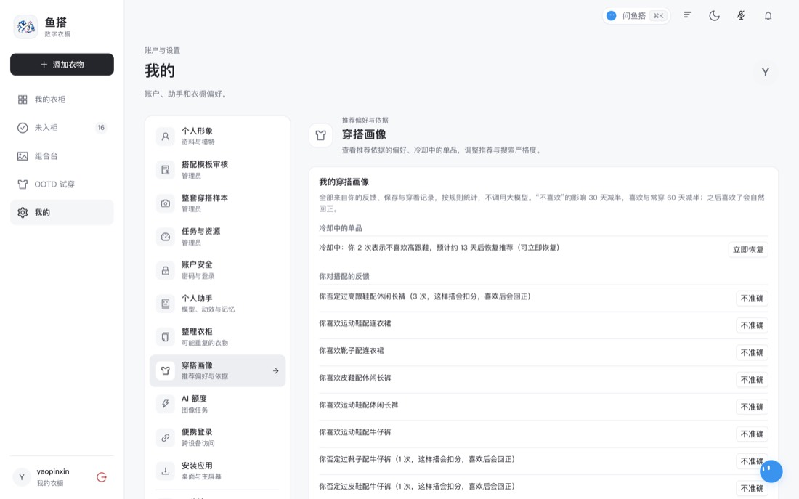
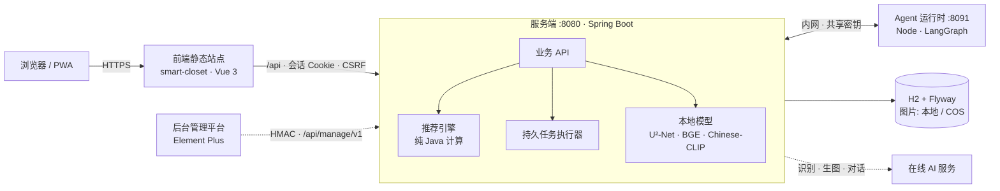

<div align="center">

# 鱼搭 · AI 数字衣柜

**拍一张照片入柜，打开就知道今天穿什么。**<br>
推荐由可解释的代码算出，大模型只负责听懂话、看懂图、画效果图。


[便携版试用](#便携版一键启动) · [源码运行](#源码运行开发) · [容器部署](#容器部署) · [文档索引](docs/README.md) · [用户端仓库](https://github.com/yumengjh/smart-closet)



</div>

---

> ### ⚠️ 许可声明：源码仅供评审查看，不是开源软件
>
> 鱼搭是独立开发、计划商业化运营的 SaaS 产品。仓库开放，**只是为了让竞赛评委核验项目的真实性与 AI 协同开发过程**。
>
> | 允许（仅限评审人员） | 禁止（未经书面授权） |
> |:--|:--|
> | 阅读源码、文档与提交历史；在自己的设备上临时克隆、构建、运行和测试，用于核验与评分 | **复制、转发、Fork、镜像、公开发布；修改或二次开发；商业或生产使用；用于训练 AI 模型；提取规则、数据与设计做相似产品** |
>
> 完整条款见 [LICENSE](LICENSE)。需要其他用途，请先取得权利人书面授权。

本仓库是**后端**：Spring Boot 4.1 / Java 21 服务端，加上 `agent-runtime/` 里的 TypeScript（LangGraph）助手运行时。
用户端界面在 [smart-closet](https://github.com/yumengjh/smart-closet)（Vue 3 + Ant Design Vue），后台管理平台通过可插拔的管理接口接入。

## 亮点

| | | |
|:--|:--|:--|
| **推荐不靠猜**<br>召回、组合、打分、换一批、搜索、取色全部零模型调用；每套搭配可拆成 11 个维度分，并说明依据 | **本地优先**<br>抠图、语义搜索、以图搜图在本机用 ONNX 模型完成；衣物完整资料、性别、身材不发给模型 | **听得懂中文风格词**<br>18 个风格画像把“千金”“多巴胺”“新中式”拆成颜色、色调、图案、面料线索加权计算 |
| **衣服越多越会选**<br>曝光均衡让被遗忘的衣物重新出场，28 天模拟里进入推荐的衣物翻了一倍 | **助手说完成才算完成**<br>后端发命令，浏览器执行后带版本号回执；用户可随时停止并接手 | **AI 功能不乱花钱**<br>持久任务、冻结输入、幂等键；结果未知不自动重发，由用户确认后重来 |

## 界面一览

<table>
<tr>
<td width="50%"><br><sub><b>快速入柜</b>：连拍上传，后台抠图与识别，随时补齐</sub></td>
<td width="50%"><br><sub><b>我的衣柜</b>：分页、颜色精确筛选、语义与以图搜图</sub></td>
</tr>
<tr>
<td><br><sub><b>推荐有依据</b>：每套搭配附带命中的规则与分项得分</sub></td>
<td><br><sub><b>多画板搭台</b>：自由组合，助手的方案落在临时画板</sub></td>
</tr>
<tr>
<td><br><sub><b>全局助手</b>：查询、检查穿搭、操作画板，操作可追溯</sub></td>
<td><br><sub><b>穿搭画像</b>：偏好可见、可恢复、可清空</sub></td>
</tr>
</table>

## 快速开始

| 我想…… | 怎么做 | 需要 |
|:--|:--|:--|
| 直接试用、给别人演示 | [便携版](#便携版一键启动)：解压，双击启动 | 什么都不用装 |
| 开发或改代码 | [源码运行](#源码运行开发) | JDK 21、Maven 3.9+、Node 22+ |
| 部署到服务器 | [容器部署](#容器部署) | Docker、反向代理 |

```bash
# 最短路径：源码运行（模型和前端的准备步骤见下文）
CLOSET_BOOTSTRAP_USERNAME=admin CLOSET_BOOTSTRAP_PASSWORD='至少12位的初始密码' ./scripts/start-with-agent.sh
# 打开 http://127.0.0.1:8080/login
```

不配置在线 AI 服务时，本地功能（入柜、抠图、搜索、推荐、画板）照常可用。

## 功能

| 模块 | 能力 | 文档 |
| --- | --- | --- |
| 账号 | 邀请码 / 开放 / 关闭三种注册模式（`CLOSET_REGISTRATION`）、昵称与登录设备管理、退出其他设备、自助注销、登录失败限流；管理员在“我的 → 用户管理”管理用户与邀请码；管理员创建的账号首次登录强制改密、会话存数据库（默认 7 天）、CSRF；每账号每日 AI 额度（图片 20 次、助手 30 次，可按用户调整）；跨设备的一次性[便携登录链接](docs/PORTABLE_LOGIN.md) | [产品接口](docs/CLOSET_PRODUCT.md) |
| 录入 | 快速入柜（默认开启）、单件与合图批量录入、识别品类/颜色/图案/结构/材质线索、本地抠图（U²-Net / GrabCut）与抠图质量本地检查、可选的生成式 AI 整理图片；处理中心统一显示任务、提醒与重试 | [识别](docs/RECOGNITION.md) · [图片工作流](docs/IMAGE_WORKFLOWS.md) · [快速入柜设计](docs/design/2026-10-05-快速入柜与统一任务执行架构.md) |
| 衣柜 | 分页与排序、人工编辑字段、回收站、本地 CIELAB 精确取色 | [产品接口](docs/CLOSET_PRODUCT.md) |
| 搜索与查重 | 本地文本向量（bge-small-zh）与字段混合的语义搜索；本地图文模型（Chinese-CLIP）支持文字找图、以图搜图与超级搜索；相似衣物提示与入柜重复提醒；未识别衣物按图片判断品类与主色 | [图像搜索测试](docs/IMAGE_SEARCH_TESTING.md) · [相似衣物设计](docs/design/2026-10-09-相似衣物提示与以图搜图设计.md) |
| 智能搭配 | 零模型调用的推荐引擎：召回、组合、打分、多样化；审美组与避坑规则、风格搭法、风格画像（甜、多巴胺、千金……）、曝光均衡、今日灵感、常住城市天气、换一批 / 换一件、反馈与冷却；每条推荐附依据 | [推荐总设计](docs/design/2026-10-08-智能搭配推荐引擎与语义召回设计.md) · [搭配审美](docs/design/2026-10-10-搭配审美实现设计.md) · [风格画像](docs/design/2026-10-10-风格画像设计.md) |
| 全身穿搭 | 一体裙与内搭、配件建议（不改总分）、整套穿搭样本采集与审核 | [全身穿搭设计](docs/design/2026-10-09-全身穿搭与呈现增强设计.md) · [样本采集规范](docs/OOTD_SAMPLE_COLLECTION.md) |
| 画板 | 多画板组合台（最多 12 块）、助手临时搭台 | [组合台](docs/OUTFIT_WORKSPACE.md) |
| 助手 | 全局个人助手：平台事实查询、经确认的操作、穿搭检查、双记忆文档、帮助文章 | [助手](docs/AGENT.md) · [平台级鱼搭](docs/PLATFORM_AGENT_OOTD.md) |
| 个人 OOTD | 基准人物、多模特、动作（自动 / 预设 / 从图片提取的动作卡）、身材调节 | [平台级鱼搭](docs/PLATFORM_AGENT_OOTD.md) · [多模特与动作设计](docs/design/2026-10-12-多模特、OOTD动作与身材调节设计.md) |
| 存储 | 图片存本机磁盘或 S3 兼容存储桶（腾讯云 COS 等），附一键迁移脚本 | [对象存储设计](docs/design/2026-10-11-对象存储（S3兼容·腾讯云COS）设计.md) |
| 管理接口 | 可插拔的 `/api/manage/v1`（默认关闭）：HMAC 鉴权，供外部管理平台读取运维状态、KPI、大屏与数仓出口、审核模板 | [接入指南](docs/MANAGEMENT_API.md) · [部署拓扑](docs/DEPLOYMENT_TOPOLOGY.md) |

**本地优先**：抠图、语义搜索、图文检索、推荐全部在本机计算，不调用模型；只有识别、助手对话、生图与 OOTD 需要在线 AI 服务。
不配置 AI 服务时，本地功能照常可用。服务不会自动下载模型，也不把衣物完整资料、性别或身材数据发送给模型。

## 架构



| 组件 | 技术 | 说明 |
| --- | --- | --- |
| 服务端 | Spring Boot 4.1、Java 21、MyBatis-Plus、Flyway、H2 文件库、Spring Session JDBC | 数据库、会话、任务队列都在 `CLOSET_STORAGE_DIR`，不需要外部数据库或 Redis |
| 本地推理 | ONNX Runtime 1.30、JavaCPP / OpenCV 4.14 | U²-Net 抠图、bge 文本向量、Chinese-CLIP 图文模型；闲置自动卸载，内存不足时降级 |
| Agent 运行时 | Node 22+、TypeScript、LangGraph.js | 只接受服务端带密钥的调用，通过服务端回调工具读写数据 |
| 前端 | Vue 3、Ant Design Vue（私有仓库 smart-closet） | 生产环境单独部署为静态站点；本地开发可发布进服务端 `static` 同源访问 |

相关仓库：[smart-closet](https://github.com/yumengjh/smart-closet)（用户端前端）；管理平台 `smart-closet-admin-server` 与
`smart-closet-admin`（Element Plus），通过管理接口接入，见[部署拓扑](docs/DEPLOYMENT_TOPOLOGY.md)。

## 便携版（一键启动）

面向演示与离线试用。每个平台一个压缩包（约 550–580 MB），自带裁剪后的 Java 21、Node 24、构建好的前端、服务端、Agent
和全部本地模型，不需要安装任何软件，也不需要联网下载。

1. 从 Release（或 Actions → Portable package 的产物）下载对应平台的压缩包：`linux-x64`、`linux-arm64`、`macos-arm64`、
   `macos-x64`、`windows-x64`。
2. 解压，双击 `start.bat`（Windows）/ `start.command`（macOS，第一次需右键 → 打开）/ 终端运行 `./start.sh`（Linux）。
3. 菜单输入 1 启动，浏览器自动打开 `http://127.0.0.1:8080`；窗口里显示管理员账号与初始密码，改密码前每次启动都会提示。

菜单还有停止、重启、运行状态、日志、环境检查、模型压力评估（按本机内存自动选完整 / 均衡 / 精简档位）、实时资源监控、
设置（端口、局域网访问、AI 服务）、重置管理员密码、备份。也可以带命令运行，例如 `./start.sh doctor --verify`。

- 使用与运维：[docs/PORTABLE_PACKAGE.md](docs/PORTABLE_PACKAGE.md)
- 设计（选型、包结构、启动器、流水线、测试与实测数据）：[便携版一键启动设计](docs/design/2026-10-18-便携版一键启动设计.md)

## 源码运行（开发）

需要 JDK 21、Maven 3.9+；使用助手还需要 Node 22+。前端源码在相邻目录 `../smart-closet`。

```bash
# 1. 本地模型（可选，缺失时相关功能自动降级；服务不会自己下载）
bash scripts/install-models.sh            # U²-Net 抠图 + bge 文本向量
bash scripts/export-image-model.sh        # Chinese-CLIP 图文模型（需要 uv，约 6 分钟），可跳过

# 2. 前端：构建并发布到本仓库 src/main/resources/static（该目录的构建产物不入库）
(cd ../smart-closet && npm ci && npm run build:server)

# 3. 启动服务端 + Agent；首次启动按环境变量创建管理员
CLOSET_BOOTSTRAP_USERNAME=admin CLOSET_BOOTSTRAP_PASSWORD='至少12位的初始密码' ./scripts/start-with-agent.sh
```

打开 <http://127.0.0.1:8080/login>，首次登录后修改密码。只要服务端时可直接 `mvn spring-boot:run`（助手不可用）。
前端开发服务器（`npm run dev`）会把 `/api` 代理到 8080，见前端仓库 README。

- 默认只监听 `127.0.0.1`；局域网访问设 `SERVER_ADDRESS=0.0.0.0`。
- AI 服务配置（地址、密钥、模型）放在 Git 忽略的 `.local/generation.yml`（示例：[docs/generation.example.yml](docs/generation.example.yml)），
  或用 `CLOSET_YUMG_*` 环境变量；密钥不会下发给浏览器。
- 账号命令（创建、重置密码、停用、启用、认领旧数据）在服务停止时执行，不会启动 Web 服务：

  ```bash
  java -jar target/smart-closet-server-0.0.1-SNAPSHOT.jar --closet-command=create-user --username=alice --initial-password=ChangeMe12345
  # 其他：create-admin、reset-password、disable-user、enable-user、claim-legacy
  ```

- 管理员可用的底层测试页：`/studio/`（抠图与贴纸）、`/workflow/`（生图工作流）。底层分割接口见
  [本地抠图与贴纸接口](docs/SEGMENTATION_API.md)。

## 容器部署

由两个容器组成：Java 服务端和 Agent 运行时（`compose.yaml`）。服务端镜像只含后端，前端作为静态站点单独部署，
见[前后端独立部署](docs/INDEPENDENT_DEPLOYMENT.md)与 [Nginx 样例](deploy/nginx/closet.conf.example)。

```bash
cp .env.example "$HOME/smart-closet-server.env"   # 填写随机的 CLOSET_AGENT_SECRET 与管理员初始密码
bash scripts/install-models.sh                     # 模型挂载到容器 /models，可以容器先启动、模型后装，不用重启
docker compose --env-file "$HOME/smart-closet-server.env" up -d
```

- 数据库、会话与图片保存在命名卷 `closet-data`；服务端只绑定宿主机 `127.0.0.1:${CLOSET_HOST_PORT:-8080}`，由反向代理对外提供 HTTPS。
- 向量模型放好 5 秒后自动加载，后台为全部衣物补算向量，期间搜索与推荐降级为字段加关键词。详见 [models/README.md](models/README.md)。
- 图片可改存 S3 兼容存储桶：设置 `CLOSET_STORAGE_TYPE=s3` 与 `CLOSET_STORAGE_S3_*`，已有数据用
  `scripts/storage/migrate-to-s3.sh --host 用户@服务器` 一键迁移（失败自动切回，`--rollback` 回滚）。
- 开启管理接口：`CLOSET_MANAGEMENT_ENABLED=true` 并配置 `CLOSET_MANAGEMENT_SECRET`，见[管理接口接入指南](docs/MANAGEMENT_API.md)。

## 配置

完整清单见 [.env.example](.env.example) 与 [src/main/resources/application.yml](src/main/resources/application.yml)。常用项：

| 环境变量 | 默认值 | 说明 |
| --- | --- | --- |
| `PORT` / `SERVER_ADDRESS` | `8080` / `127.0.0.1` | 监听端口与地址 |
| `CLOSET_STORAGE_DIR` | `./data` | 数据库、会话、锁与本机图片 |
| `CLOSET_STORAGE_TYPE` | `local` | `local` 或 `s3` |
| `CLOSET_BOOTSTRAP_USERNAME` / `PASSWORD` | 空 | 首次启动创建的管理员（账号不存在时才创建） |
| `CLOSET_AGENT_SECRET` | 空 | 服务端与 Agent 的共享密钥，至少 32 字符 |
| `CLOSET_AGENT_RUNTIME_URL` / `CALLBACK_URL` | `http://127.0.0.1:8091` / `:8080` | Agent 地址与回调地址 |
| `CLOSET_YUMG_BASE_URL` / `API_KEY` / `DEFAULT_MODEL` | 空 | 在线 AI 服务；为空时只用本地功能 |
| `CLOSET_MODEL_PATH` | `./models/u2net.onnx` | 抠图模型 |
| `CLOSET_EMBEDDING_MODEL_PATH` | `./models/embedding-fp32.onnx` | 文本向量模型（内存紧张可换 int8） |
| `CLOSET_IMAGE_MODEL_PATH` / `CLOSET_IMAGE_TEXT_MODEL_PATH` | `./models/image-*-int8.onnx` | 图文模型图像塔 / 文本塔 |
| `CLOSET_QUICK_INTAKE_ENABLED` | `true` | 快速入柜 |
| `CLOSET_REGISTRATION` | `INVITE` | 自助注册：`CLOSED` 关闭 / `INVITE` 凭邀请码 / `OPEN` 开放，见[账号设计](docs/design/2026-10-19-用户账号：注册、资料与管理设计.md) |
| `CLOSET_CORS_ALLOWED_ORIGINS` / `CLOSET_COOKIE_SECURE` | 空 | 前后端跨域部署时的前端 Origin 与 Cookie Secure |
| `CLOSET_MANAGEMENT_ENABLED` | `false` | 管理接口 |
| `CLOSET_RECOMMEND_*` | `true` | 推荐机制开关（审美组、均衡、外套计暖、搭法、风格画像），关闭后回到 P4 行为 |

`pom.xml` 按当前系统与架构选择 OpenCV 本地库，可用 `-Dnative.platform=linux-x86_64` 等指定；ONNX Runtime 版本为
`onnxruntime.version` 属性（默认 1.30.0，1.24 起不再提供 macOS x64 库）。

## 模型

| 文件 | 用途 | 获取 |
| --- | --- | --- |
| `u2net.onnx`（168 MB） | 抠图 | `scripts/download-model.sh` |
| `embedding-fp32.onnx` / `embedding-int8.onnx` | 文本向量（语义搜索、推荐召回） | `scripts/download-embedding-model.sh` |
| `image-model-int8.onnx`、`image-text-model-int8.onnx` | 图文模型（文字找图、以图搜图、查重） | `scripts/export-image-model.sh`（从官方 PyTorch 权重导出并对拍） |

下载均校验固定的 SHA-256。来源、许可证、输入输出约定与精度实测见 [models/README.md](models/README.md)。

## CI/CD

日常检查在 CircleCI（`.circleci/config.yml`），每次推送与 PR 运行：`java` 任务跑 `mvn verify` 和后端包检查（不得混入测试夹具与本地前端产物），`agent` 任务跑 Agent 测试与构建。GitHub Actions 只在打 `v*` 标签或手动运行时使用：

| 工作流 | 触发 | 内容 |
| --- | --- | --- |
| `container.yml` Backend containers | `v*` 标签、手动 | `mvn verify`、Agent 测试与构建、构建两个镜像并推送到 GHCR |
| `deploy.yml` Deploy | `v*` 标签的容器构建成功后；或手动 | 通过 SSH 部署到服务器：补齐模型、同步 compose、拉镜像、等健康、失败回滚 |
| `portable.yml` Portable package | 改动便携相关文件、`v*` 标签、手动 | 构建五个平台的便携包，在各自平台解压后冒烟测试；`v*` 标签时附加到 Release |

前端仓库的日常检查同样在 CircleCI，部署工作流在推送 `v*` 标签时发布静态站点。便携版工作流用只读 deploy key（secret
`FRONTEND_DEPLOY_KEY`）检出前端。

GitHub Actions 额度不足时，同样的发布流程也可以在 CircleCI 上跑（`.circleci/config.yml`，GitHub 的工作流原样保留）：

| CircleCI 工作流 | 触发 | 内容 |
| --- | --- | --- |
| `release` | `v*` 标签 | 测试 → 构建并推送 GHCR 镜像（`版本号`、`sha-<7位>`）→ SSH 部署；同时构建五个平台的便携包并附加到 Release |
| `manual-deploy` | Trigger Pipeline，参数 `deploy_image_tag` | 部署已发布的镜像标签，不构建 |
| `portable` | Trigger Pipeline，参数 `portable=true` | 构建便携包；可选 `portable_platforms`、`frontend_ref`、`portable_release` |

环境变量在 CircleCI 项目设置里配置，名字与 GitHub secrets 相同，另加 `GHCR_USER`、`GHCR_TOKEN`（classic PAT，
`write:packages`、`read:packages`，发布便携包还需 `repo`），完整清单见配置文件开头。**两边都响应 `v*` 标签**：Actions 额度
恢复后若继续用 CircleCI，先在 GitHub 上禁用 `container.yml`、`deploy.yml`、`portable.yml`（Actions → 选中工作流 →
Disable workflow），否则同一个标签会被部署、发布两次。

## 测试

```bash
mvn test                       # 全部单元与集成测试，不需要模型文件
mvn verify                     # 同上，加打包检查（CI 运行这个）
(cd agent-runtime && npm test) # Agent
```

推荐引擎的守护测试：`GoldenOutfitsTest`（好坏搭配考试题）、`AestheticRulesTest`、`AestheticSpreadTest`、`ExposureBalanceTest`、
`StyleLooksTest`、`SemanticSearchTest`；改规则后用 `RecommendationSnapshotTest` 生成快照对比页。真实模型相关的测试
（对拍、基准、评估）在模型文件存在时启用，命令见 [models/README.md](models/README.md) 与
[图像搜索测试](docs/IMAGE_SEARCH_TESTING.md)。抠图样本对比与贴纸预览见[本地抠图与贴纸接口](docs/SEGMENTATION_API.md#测试与图片对比)。

## 代码结构

```text
src/main/java/com/smartcloset/
  api/            HTTP 接口、错误响应、前端路由回退
  security/       账号、会话、CSRF、额度、便携登录、离线账号命令
  garment/        衣物档案、分类、汇总
  intake/         快速入柜与抠图检查
  batch/          合图批量录入
  processing/     统一任务队列与执行器
  workflow/       生图与图片工作流
  recognition/    多模态识别
  image/          解码与方向、U²-Net / GrabCut、蒙版、贴纸
  semantic/       分词器、文本向量、语义与混合搜索
  similar/        图文模型、相似衣物、查重
  recommend/      推荐引擎（召回、打分、审美组、规则、均衡、风格画像）
  outfit/         搭配与人物贴纸
  person/         个人资料、基准人物、模特、动作卡、OOTD
  ootd/           整套穿搭样本采集
  agent/          助手会话、工具、记忆、命令
  notification/   站内通知
  weather/        天气（Open-Meteo）
  storage/        本机与 S3 存储
  management/     可插拔管理接口（核心包不得依赖它）
  portable/       便携版停止文件监视（仅便携版启用）
src/main/resources/
  recommend/      审美规则、风格画像、搭法等数据文件
  help/           帮助文章（助手与帮助页使用）
  db/migration/   Flyway 迁移
agent-runtime/    TypeScript Agent 运行时
portable/         便携版启动器、平台启动文件与 CI 组装脚本
scripts/          模型下载与导出、部署、存储迁移、评估脚本
```

## 开发约定

仓库根目录的 [AGENTS.md](AGENTS.md) 记录了必须遵守的约定，包括前端改动流程、推荐引擎与审美规则的测试要求、管理接口契约同步、
全身穿搭与 OOTD 的隐私边界、便携版的维护要求。

## 许可

本仓库采用[鱼搭源码可见评审许可](LICENSE)：**源码仅供竞赛评审人员核验之用，不是开源软件**。未经权利人书面授权，不得复制、转发、公开发布、Fork、修改、二次开发、商业使用，或将其用于训练 AI 模型。第三方组件与预训练模型遵循各自原有的许可证。
