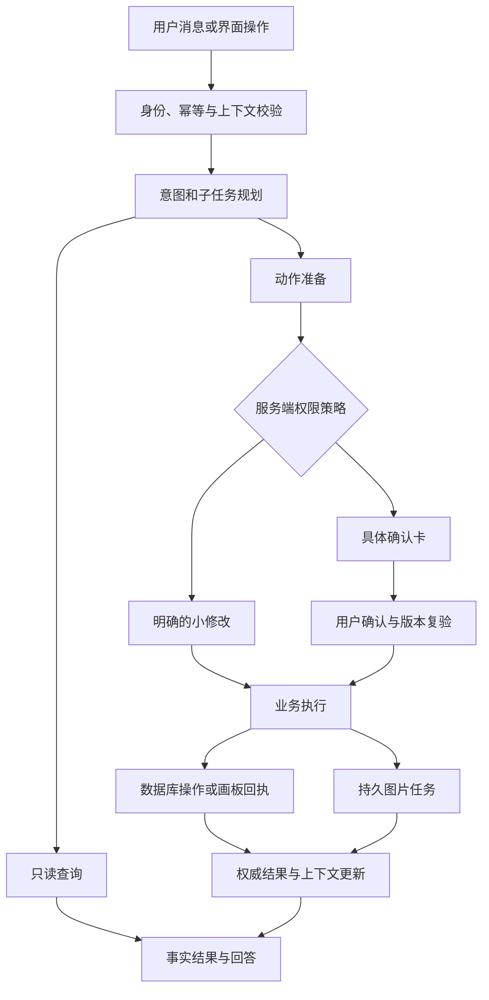

# 鱼搭平台级 Agent、个人基准人物与 OOTD 完整设计

**设计状态：已完成讨论并确认，待保存到项目。**
**设计日期：2026-10-06。**

本设计将鱼搭升级为能查询平台事实、理解当前工作区、执行授权操作、维护长期记忆的个人助手，同时建立“个人资料 → 基准人物 → 已保存搭配 → OOTD”的完整链路。

当前处于规划模式，尚未写入项目文件。开始实施前，必须先将本文完整保存至：

`/Users/yaopinxin/project/smart-closet-server/docs/design/2026-10-06-平台级鱼搭助手与个人OOTD设计.md`

同步更新项目文档索引，并保存用户的持续偏好：**后续设计优先使用现有数据、本地计算和确定性规则，避免频繁调用 AI 生图或识别。上述保存工作先于任何代码实施。**

## 一、已确认的产品约定

| 事项 | 定稿决定 |
|---|---|
| 助手定位 | 平台日常查询、操作、穿搭与普通问答 |
| 通用联网 | 首版不加入；不能核实的最新外部信息明确说明 |
| 主动交流 | 聊天内轻量建议，问候不会自行触发搭配 |
| 操作权限 | 查询直接完成；明确的小修改可直接执行并撤销；删除、批量、覆盖、付费生成先确认 |
| AI 使用 | 统计、过滤、穿搭检查、资料默认值计算不调用识图或生图 |
| 账号性别 | 必须选择男或女才能生成基准人物；其他平台功能不受此限制 |
| 其他个人资料 | 可选，有则使用；缺失时采用明确的生成默认值 |
| 基准人物 | 有照片与无照片均可生成；在“我的设置”管理 |
| 全身照用途 | 用于生成基准人物，不作为 OOTD 的直接参考 |
| OOTD 前提 | 已确认基准人物、已保存搭配、穿搭检查通过 |
| OOTD 数量 | 每次单张，不自动追加候选或重生 |
| 未选鞋 | 提示后可继续，结果不带鞋 |
| OOTD 保存 | 专门生成页面列表，刷新和跨设备仍在，保留到用户删除 |
| 图片删除 | 分别管理；OOTD 直接删除，不进入回收站 |
| 长期记忆 | 通用、敏感两份原始文档；设置直接展示和编辑 |
| 通用记忆维护 | 用户和 Agent 共同维护；局部维护提示并可撤销 |
| 敏感记忆 | 保存先确认；读取按用途授权 |
| 天气 | 本次完整设计，后续独立接入 |

## 二、现状与需要解决的问题

当前后端和前端已具备登录、衣物档案、组合台、助手会话、操作回执和持久任务队列，可以继续复用。

本次只读调研确认：

1. 助手目前主要是“模型回复 → 工具 → 模型回复”的循环，全部工具同时开放，缺少独立的意图和动作权限控制。
2. 数量问题本来可以从库存查询得到，但没有专门的统计工具，也没有阻止查询轮次调用搭配工具的服务端门槛。
3. 历史修复已加入禁止双外套、限制主体数量、保守叠穿和合法候选筛选。最近的双外套体验不能直接归因为“没有规则”。
4. 手动画板、旧组合、显示角色与真实品类不一致，以及执行期间资料变化，仍可能保留或产生不合理结果。
5. 当前记忆每轮全量注入；删除后，旧聊天事件仍可能把内容带回后续上下文。
6. 当前人物是公共贴纸，没有账号个人资料、个人基准人物或 OOTD 领域。
7. 生图接口目前主要是单图输入，需要补齐人物与多件衣物的参考协议。

实施前应核对失败记录中的运行版本、原始问题、衣物资料、工具调用和最终画板。**没有对应证据时，不将某条推测写成已确定的故障原因。**

前端现有未提交修改需要保留，不能因本次设计覆盖。

## 三、平台级 Agent 架构

### 3.1 职责划分

沿用现有 Spring 后端、LangGraph 运行时、H2 和统一任务执行器。

- **后端**负责事实查询、身份权限、动作授权、版本校验、业务写入和任务状态。
- **Agent**负责理解表达、拆分目标、选择允许的能力、解释结果。
- **前端**负责展示、用户确认、当前画板快照和浏览器操作回执。
- **任务执行器**负责图片生成的排队、资源许可、取消、结果落盘与重启恢复。

Node 不直接操作数据库、文件系统，也不获得任意网络请求或通用 SQL 工具。

### 3.2 意图与工具分组

每轮按实际目标开放能力，不能因为历史中讨论过穿搭，就让当前数量问题获得搭配权限。

| 意图 | 可用能力 | 行为 |
|---|---|---|
| 衣柜查询 | 统计、筛选、详情 | 回答事实，不创建搭配 |
| 组合台查询 | 已保存组合、当前工作区摘要、穿搭检查 | 展示情况，不修改 |
| 穿搭建议 | 条件查询、合法候选、方案解释 | 明确请求后才推荐 |
| 平台修改 | 准备业务命令 | 按权限等级执行 |
| 记忆管理 | 允许的文档读取与修改 | 按普通、敏感策略处理 |
| 平台帮助 | 帮助检索、明确导航 | 提供平台内来源 |
| 普通聊天 | 普通问答 | 不顺带创建任务 |
| 不明确请求 | 必要查询、澄清 | 不自行猜测修改目标 |

纯统计、问候和能力咨询轮次不开放衣物修改、画板修改、长期记忆写入或图片任务提交权限。模型即使错误请求这些工具，后端也拒绝。

意图判断不是绝对可靠的语义识别。安全边界来自**工具权限和业务网关**，不能只靠提示词、正则或模型声明。

### 3.3 多意图、指代和上下文

- “我有多少衬衫，顺便把选中的这件改成夏季”：分别处理查询与修改。
- 一个分支不明确时，只暂停依赖它的动作，独立查询仍可完成。
- “这件”“当前这套”绑定明确的衣物、画板、组合及版本；目标不唯一时展示候选。
- “能帮我把这件改成……”属于明确操作请求；“你会修改衣物吗”属于能力咨询。
- 历史助手回复、记忆、工具结果和帮助文章不能授予本轮操作权限。
- 同轮修改成功后，更新权威版本与上下文，后续查询不能继续使用旧快照。
- 页面或选中项变化时，不把尚未执行的命令悄悄转移到新目标。

### 3.4 命令和确认

每个写操作建立独立命令，包含目标、参数、预期版本、执行等级、幂等标识和结果。

| 等级 | 示例 | 处理 |
|---|---|---|
| 只读 | 数量、详情、任务状态、穿搭检查 | 直接完成 |
| 可撤销小修改 | 单件名称、收藏、明确属性修改、临时画板调整 | 执行后展示变化与撤销 |
| 确认操作 | 回收、批量修改、覆盖已保存组合、图片生成 | 展示具体对象、变化、数量和额度 |
| 不支持 | 密码修改、管理员配置、任意文件或数据库操作 | 引导原有页面 |

确认绑定具体参数和版本，不是长期授权。参数、目标或版本变化后，需要重新准备。

统一确认流程，避免“助手确认一次，保存弹窗再确认一次”。组合操作如“保存并生成 OOTD”可以使用一张完整确认卡，但必须先保存成功，再提交生成；部分完成时如实显示结果。

撤销同样检查版本。用户后来已经修改过该对象时，不能用撤销覆盖新修改。

## 四、衣柜统计和平台信息能力

### 4.1 统计口径

默认统计已入柜 `ACTIVE` 记录，待入柜与回收站单列。

- 一件衣物的多张图片、识别任务、复制贴纸不增加数量。
- 裙子包括连衣裙和半身裙，并展示拆分。
- 衬衫、裤子使用统一类别族和确定的同义词映射。
- 季节标签可以重叠，分组之和不一定等于衣柜总数。
- 缺失或含义不明的数据单列“未知／待核对”，不当作零。
- “适合夏天”的数量默认指已有夏季标签；新的适穿建议另行说明。
- 鞋包配饰仍属于库存记录，回答可同时展示主体衣物和配饰分组。
- 一双鞋、一对耳饰按录入物品记录计数；历史左右拆条或套装含义不明时提示核对，不自动合并。

统计响应返回数量、筛选条件、口径、未知数量、查询时间和衣柜版本。数字由后端聚合产生，不能让模型翻页计数或从候选池推算。

零匹配必须返回零，不能用全衣柜回退结果冒充匹配数量。

### 4.2 查询投影与分类

建立轻量查询投影，避免每次统计都逐件加载图片和任务历史。

投影保留：

- 账号、衣物 ID、状态和 revision；
- 原始品类与派生规范品类；
- 季节、颜色、风格等有效标签及来源；
- 名称、收藏和可查询的穿着资料；
- 分类映射版本与待核对状态。

确定的同义词可以映射；“裙装”“套装”等含义不唯一时保留原值并标待核对。用户确认资料优先，新识别不能覆盖人工事实。

衣柜列表、统计和搭配候选必须使用相同查询语义。迁移仅做本地映射，**不批量重新识别历史衣物**。

### 4.3 其他平台能力

新增或补齐：

- 已保存搭配列表、详情和数量；
- 当前浏览器工作区、画板、选中物品和未保存状态；
- 用户任务列表、进度、排队原因、可用操作；
- 衣物名称、收藏、有效属性修改；
- 回收与恢复；
- 按确认启动识别、图片处理及安全取消；
- 基准人物与 OOTD 查询、生成、删除。

本机未保存草稿与服务端保存组合分别说明，不把本机草稿称为跨设备数据。任务查询返回用户可理解的摘要，不暴露内部载荷或供应商配置。

## 五、穿搭方案、全身分布与搭配规则

### 5.1 画板和穿着方案分离

保留自由拼贴画板 `Scene`，新增语义穿搭方案 `OutfitPlan`。

画板表达位置、大小、裁切和装饰；穿搭方案表达**一名人物实际穿哪套物品、各物品怎样穿**。

`OutfitPlan` 最少包含：

- 来源搭配或画板及版本；
- 一名穿着者；
- 真实衣物 ID、衣物 revision、参考资产；
- 本次穿着角色与层次；
- 必选、排除、场合和天气条件；
- 校验结果、规则版本与内容指纹。

同一衣物复制多张贴纸仍只穿一次。不同位置、不同图片或更名不构成新的搭配；仅换配件的结果标记为同一主体的变体。

手动画板允许多套、多人和自由摆放。进入 OOTD 前必须明确选择一套和一名人物，不能按左右位置猜测，更不能把全部元素混穿。

### 5.2 “全身穿搭分布”弹窗

组合台增加 **“穿搭检查”** 入口，OOTD 前使用同一检查结果。

弹窗展示简洁身体示意和物品列表，每个区域显示：

- 已有；
- 缺少；
- 冲突；
- 资料未确认。

分析读取现有衣物资料、方案和用户指定穿法，**不调用 AI 识图或生图**。

| 区域 | 规则 | 缺失或冲突处理 |
|---|---|---|
| 上身主体 | 上下装模式须有一件 | 缺失或重复主体阻止 OOTD |
| 下身主体 | 裤子、半身裙等均可 | 缺失或重复主体阻止 |
| 连体主体 | 连衣裙、连体衣替代上下装 | 不要求另选裤子；默认不能叠加另一主体 |
| 外搭 | 可选，最多一件 | 双外套或叠穿资料不足阻止 |
| 内层／打底 | 普通主体可处于外搭里面；独立打底需明确多层模式 | 不自动补衣服；无必要内搭不阻止 |
| 鞋 | 可选，最多一双所属物品 | 缺鞋提示后可继续，结果不带鞋 |
| 帽子、眼镜 | 可选，各最多一个所属物品 | 明确重复位置冲突需修正 |
| 首饰 | 展示耳、颈、手腕、手等位置 | 合法不同首饰可共存，同物品重复需修正 |
| 围巾、腰带、袜、手套、包 | 可选，按位置检查 | 缺失不阻止，不为凑数自动添加 |
| 未确认物品 | 无法确定穿着角色 | 用户核对或排除；不能猜测通过 |
| 人物 | 一名已确认基准人物 | 缺失或未选择时阻止 |

不可见内衣不要求录入，也不从照片或其他资料推断。

普通可选配饰为空只展示，不逐项弹窗打扰。缺鞋提示集中在生成确认中，明确“不带鞋”。

### 5.3 硬拦截和软提示

以下情况禁止 OOTD：

- 没有完整“上装＋下装”，也没有连体主体；
- 双外套、主体重复或其他明确位置冲突；
- 物品角色无法判断；
- 多套或多人未明确选择；
- 衣物已回收、归属不符或参考资产不可用；
- 叠穿缺少已核对的必要资料；
- 搭配未保存、保存失败或版本已变化；
- 没有已确认基准人物。

缺鞋、普通配饰缺失、天气资料不足等允许提示后继续。

**不能用基准人物原本的上衣、裤子或鞋补齐不完整搭配。**

检查弹窗提供具体修正入口：添加下装、移除外套、选择一套、排除展示素材、核对品类或补充穿着资料。修正本身不触发重新识别。

### 5.4 日常与多层规则

- 日常：一件主体上装＋一件下装，或一件连体主体；可加一件外搭。
- 仅用户明确要求多层时，允许最多“打底＋主体＋外搭”。
- 每件物品本次只占一个角色，不能同时作为主体和外搭。
- 双外套始终禁止，不能通过修改显示分组绕过。
- 逐层检查已核对的用途、版型和厚薄，沿用保守兼容要求。
- 缺资料只核对本次相关衣物，不强制补全整个衣柜。
- 假两件和上下异色连衣裙仍是一件，不拆成两层。
- 固定领结、腰封等属于原衣物，不作为独立配饰重复添加。

结构规则只能证明输入满足约束，不能证明真实尺寸合身或审美一定合适。

### 5.5 候选质量

- 全量库存先按条件筛选，必选衣物不能因“不在最新 1000 件”被遗漏。
- 合法主体与配件分阶段扩展，避免候选池被某种品类占满。
- 默认三套优先使用不同主体；不足时说明是配件变体。
- 不为了凑齐三套而违反结构、删除必选物品或编造衣物。
- 鞋缺失时称“主体搭配”，不声称全套物品齐备。
- 新建、替换、接受、执行回执和 OOTD 准备均调用同一规则服务。

## 六、个人资料与基准人物

### 6.1 设置入口和真实资料

“我的设置”新增个人资料与基准人物分区。

真实资料保存用户填写的：

- 性别：男／女；
- 身高、体重；
- 体型或身材描述；
- 可选围度；
- 合身、穿搭与冷暖偏好。

缺失字段保持空值。账号未填写性别时，禁止生成基准人物，但不阻止查询衣柜或编辑组合台。

身高统一 cm、体重统一 kg。零、负数、非数值和单位错误应明确修正，不能悄悄套用默认值。

### 6.2 本次生成默认值

每次建立独立、不可变的生成资料快照，标记每个值来自用户、模板或计算。

| 字段 | 有用户填写值 | 缺失时 |
|---|---|---|
| 性别 | 使用账号选择 | 阻止生成 |
| 身高 | 使用填写值 | 男 170 cm、女 160 cm |
| 体重 | 使用填写值 | `22 × 有效身高（米）²`，保留一位小数 |
| 体型 | 使用填写描述 | 标准模板 |
| 围度 | 使用填写值 | 不补、不反推 |
| 照片 | 使用选定照片 | 使用模板外观 |

例如：

- 男，身高体重未填：170 cm、示意体重 63.6 kg。
- 女，身高体重未填：160 cm、示意体重 56.3 kg。
- 已填 185 cm、未填体重：示意体重 75.3 kg。
- 已填体重、未填身高：保留体重，只使用默认身高，不反算身高。
- 两项均已填写：不使用 BMI 替换。

BMI 22 是本设计选择的生成占位常数，不是对用户真实体重或健康状况的判断；计算公式参考 [CDC 的 BMI 说明](https://www.cdc.gov/bmi/faq/index.html)。

默认值不写回个人资料、长期记忆或衣柜事实，也不从身高体重反推真实围度。

### 6.3 照片和生成流程

首版使用简洁表单，不增加复杂轮廓编辑器。

- 无照片：资料和模板默认值 → 确认 → 单次生成人物。
- 有照片：通过明确的“上传并生成基准人物”操作提交，上传成功后立即建立生成任务，不重复确认。
- 提交前展示实际使用资料、参考照片、供应商及额度。
- 本地只处理格式、方向、尺寸和元数据，不额外做人像识别、测量或体型分析。
- 照片用于参考本人可见外观；模板默认值不能强行改变照片中的脸或身材。
- 照片旧、资料新时展示输入供用户核对，不声称程序已经判断谁更准确。

默认人物：全身、自然站姿、简洁背景、素色合体短袖、普通及膝短裤和简洁平底鞋。基础服饰只用于人物建立，不能成为后续搭配的隐藏物品。

生成成功先展示候选。用户确认满意后设为默认人物，不自动覆盖已有默认版本。

### 6.4 版本与管理

资料、参考照片和基准人物分别管理。

- 修改资料不自动生图。
- 性别、身高、体重或体型变化时，提示当前人物基于旧资料。
- 用户可明确继续使用旧人物，或重新生成。
- 颜色、风格偏好变化不要求重生人物。
- 排队任务保持提交时输入。
- 删除默认人物后清空默认指针，新 OOTD 需重新选择人物。
- 未生成、未确认、生成失败或已删除的人物不能用于 OOTD。

## 七、OOTD 流程、生成协议与结果

### 7.1 页面和主流程

OOTD 有专门生成页面，组合台提供入口。

1. 检查当前修改是否已经保存。
2. 保存成功后取得搭配 ID 和 revision。
3. 选择已确认基准人物。
4. 免费执行穿搭检查，选择本次一套物品。
5. 展示清单、缺失提示和生成额度。
6. 确认后冻结输入，提交单张任务。
7. 任务完成后加入个人结果列表。

未保存修改不能悄悄改用旧版组合生成。保存冲突时保留用户输入，停止后续生成。

离开页面或关闭助手不丢任务。用户可在生成页面和任务中心查看进度。

### 7.2 输入和提示词

OOTD 的直接输入仅包含：

- 已保存搭配及版本；
- 已确认基准人物及版本；
- 已选真实衣物参考及 revision、资产 hash；
- 本次穿着角色、层次、排除项；
- 已授权的必要资料、偏好与输出设置。

**不发送上传的全身照作为 OOTD 直接参考。**

优先使用原衣物或现有无描边基础图，AI 增强展示图不能成为唯一实物依据。缺少可用参考时让用户更换，不自动付费补图。

提示词明确：

- 保留所选基准人物外观；
- 替换基础服饰，不能在其外面继续叠加；
- 只使用本次确认的物品和层次；
- 未选鞋时不带鞋，并去除基准图原鞋；
- 未选帽、眼镜、包、首饰等不自动补齐；
- 输出一名人物、一套搭配、一张正常全身图。

这些是生成约束，不是对模型结果百分之百正确的保证。

### 7.3 多参考能力

扩展现有生成输入为带用途的参考列表，区分人物、实物衣物和可选布局参考。

每个供应商／模型记录：

- 支持用途；
- 最大参考数量和输入限制；
- 输出比例、尺寸和数量；
- 已验证状态、日期和版本。

官方图像接口的多参考能力也因模型而异，不能凭模型名或目录返回就认定当前网关支持。参见 [Gemini 官方图像生成文档](https://ai.google.dev/gemini-api/docs/image-generation)。

默认仅开放已验证方案：

- 参考数量不足不能默默丢物品。
- 不静默换模型或换人物。
- 单图参考拼图只有经过独立验证并明确说明时才可启用，默认关闭。
- 无可用模型时，资料、统计和穿搭检查仍可使用，生成入口说明不可用。

### 7.4 列表、反馈和删除

结果列表保存缩略图、来源搭配、人物版本、生成时间和状态。

- 刷新、换设备仍可查看。
- 不自动加入衣柜，不覆盖组合台。
- 来源搭配后来改变时，历史结果仍对应旧版本。
- 来源搭配或人物删除后，已生成结果可以独立保留。
- 提供“人物不像、衣服不对、多了一件、花纹变化、基础服饰残留”等反馈。
- 反馈不会自动重新生成。
- 再次生成建立新任务，保留旧结果并重新确认。
- 删除直接清除该图、缩略图和相关内部副本，没有回收站。

## 八、通用与敏感长期记忆

### 8.1 原始文档

每账号维护两份逻辑 Markdown 文档：

- 通用长期记忆；
- 敏感长期记忆。

设置直接展示原始内容，用户可编辑；底层使用 H2 保存内容和 revision，可导出为文件。Agent 获得受控文档工具，不获得任意磁盘写权限。

结构化资料是身体数值的权威来源。记忆中的相关描述不能静默覆盖已填写资料；发生冲突时展示并核对。

### 8.2 Agent 管理权限

通用文档支持添加、更新、删除过时内容、合并和整理。

- 依据当前对话中的用户表达，不从衣物图片猜测个人偏好。
- 局部维护展示实际变化，允许撤销。
- 整份清空、大范围删除或覆盖先确认。
- 单次穿搭要求不自动转为长期偏好。
- 纯查询、问候不顺带整理记忆。
- 沿用当前对话流程，不启动独立后台模型维护任务。

维护仍受当前模型、工具和时间预算限制，不能称为零成本。

敏感文档的 Agent 修改必须先展示具体内容并确认。用户在设置中明确保存编辑内容，即完成本次保存确认。

### 8.3 敏感读取授权

保存授权和使用授权分开。

用户可授权用于个性化搭配、基准人物或 OOTD；普通问答、数量查询不读取身体资料。

用途授权只允许相关片段进入对应任务，不能整份敏感文档外发。后端派生的实际授权绑定文档版本、片段、任务和有效期；文档变化后重新检查，新增内容不自动继承原授权。

通用文档中混入明显敏感内容时，提示转入敏感文档；不能以“放在通用组”作为自动外发依据。自由文本判断存在局限，不作绝对识别保证。

### 8.4 并发和忘记

- 用户与 Agent 的编辑均检查 revision。
- 冲突保留未提交内容，不自动覆盖。
- 撤销要求当前版本仍对应原操作。
- 删除内容后，历史记忆事件、摘要和检索投影不得继续带回模型。
- 来源无法可靠追溯时，提升上下文 epoch，保守排除此前不安全的历史投影。
- 原始聊天可继续供用户查看，但不等于继续作为模型输入。
- trace 不作为助手检索来源。
- 正在运行的相关回复尽力停止，后续调用重新检查记忆版本。

已经发送到上游的内容无法通过本平台“忘记”撤回，界面不能作此承诺。

## 九、数据、接口与兼容设计

### 9.1 核心数据

| 资源 | 主要内容 |
|---|---|
| `wearer_profile` | owner、revision、性别、用户填写资料、默认人物指针 |
| `person_baseline` | 人物版本、图片、来源快照、确认状态 |
| `private_media` | owner、用途、文件、hash、状态、删除代次 |
| `outfit_plan` | 来源搭配版本、穿着者、衣物与穿法、检查结果 |
| `image_render_job` | BASELINE／OOTD、冻结输入、状态、模型与提示词版本、输出 |
| `agent_command` | 目标、参数、版本、等级、幂等、确认和执行结果 |
| `agent_memory_document` | 通用／敏感、原始内容、revision、来源记录 |
| 查询投影 | 统一分类、有效标签、状态和衣柜版本 |
| 媒体关系 | 生成来源与真实直接输入分别记录，支持独立删除 |

生成默认值只存在于快照。基准人物、照片和 OOTD 不进入 garment 表或衣柜统计。

### 9.2 主要公共接口

继续使用登录会话和现有 CSRF 规则。

| 接口组 | 最小能力 |
|---|---|
| `/api/closet/summary` | 结构化统计、分组、未知数量、时间与版本 |
| 衣物查询与修改 | 新增名称、收藏；复用属性、回收、恢复服务 |
| `/api/me/wearer-profile` | 读取、按 revision 更新真实资料 |
| `/api/me/person-baselines` | 生成人物、列表、详情、确认启用、删除 |
| 参考照片接口 | 私有上传、查看、删除；上传生成操作关联一次任务 |
| `/api/outfit-reviews` | 免费检查已保存搭配或当前工作区 |
| `/api/ootd/preparations` | 冻结准备记录、清单、提示和额度信息 |
| `/api/ootd/jobs` | 单张提交、列表、详情、取消、结果删除 |
| `/api/agent/commands` | 详情、确认、取消、撤销 |
| `/api/agent/memory-documents` | 两份原始文档读取、局部修改、全文编辑 |
| 敏感用途授权接口 | 用户界面创建或撤销用途许可 |
| 用户任务接口 | 安全摘要、状态、可用操作 |

准备记录和确认默认有效期为 10 分钟。过期后免费重新检查，不自行生成。

旧 Agent proposal、搭配保存与会话接口保留兼容入口，内部转到统一权限和命令服务。旧客户端不能绕过新校验。

### 9.3 关键类型

- `CommandResult`：状态、实际变化、最新版本、可否撤销、安全错误。
- `CompositionReview`：各槽位、阻断项、提示项、规则版本、内容指纹。
- `RenderProfileSnapshot`：有效值、各值来源、资料版本、默认策略版本。
- `GenerationRequest`：用途、参考列表、输出要求、模型能力版本。
- `ToolError`：错误代码、执行阶段、结果是否确定、允许的恢复操作。

模型不能自行填写账号归属、操作等级、确认结果或授权状态。

## 十、任务、费用、取消与删除边界

### 10.1 统一任务执行

扩展现有执行器的业务适配，消除只读取旧 workflow／batch 表的硬编码。

人物和 OOTD 复用生成资源池、账号公平调度、助手保留容量和资源许可，不另建 MQ 或第二套执行器。

公开任务详情只返回安全投影。人物照片、身体资料、模型输入和原始载荷不能直接出现在通用任务详情中。

### 10.2 状态与费用

生成任务采用：

`QUEUED → WAITING_RESOURCE → RUNNING → SUCCEEDED / FAILED / UNKNOWN`

另有 `CANCEL_REQUESTED / CANCELLED / DELETED`。人物是否确认单独记录。

- 每次人物或 OOTD 单张生成沿用一个图像额度单位。
- 初期共享当前每日图像额度，不另建重复计数。
- 准备、检查、查看结果不扣生成额度。
- 提交与派发均检查资格和额度。
- 未派发失败按现有规则不计或退还。
- 已派发、结果未知时不假称未消耗。
- 无可靠金额信息时不展示虚构价格。
- 新人物／OOTD 不因额度不足隔天自动生成。
- 不自动重发图片请求；本地处理恢复和等待资源不属于重新生图。

继续沿用当前聊天限额、工具和时长配置；补齐模型调用总数与输入预算，所有工具尝试都计入预算，防止异常循环。

### 10.3 幂等、重启和取消

- 双击、刷新或重复确认返回原任务，不重复扣额度。
- 数据库修改使用短事务；不能持有事务等待浏览器或上游。
- 画板操作复用 operationId、顺序、版本和 ACK。
- ACK 丢失时核对结果，不能盲目重复操作。
- 重启可恢复排队、本地步骤和已落盘回执。
- 已派发且结果未知的请求不自动重跑。
- 关闭页面不取消持久图片任务。
- 停止聊天和取消图片任务分别处理。
- 取消生成只保证本平台停止后续发布，不能保证上游停止或返还费用。

### 10.4 私有媒体与删除

照片、人物、OOTD 均按本人账号访问，管理员不能通过管理页读取其他用户图片。沿用便携登录的同账号权限，不把它当公开分享链接。

新照片规范化方向并清除 EXIF／GPS；不在本机持久缓存私人照片，不以公共链接暴露。私有媒体使用禁止持久缓存的响应策略。

删除首先撤销访问并记录删除代次，再清理图片、缩略图、参考副本、暂存和回执。清理失败显示处理中并重试，不能提前声称完成。

例如：

- 仅删除全身照 A：保留已生成的人物 B 和 OOTD C。
- 正在使用 A 生成人物时删除 A：阻止该任务继续发布。
- 删除 B：保留已经生成的 C，但阻止新的或正在使用 B 的生成。
- 删除 C：只清除该 OOTD。
- 只有明确选择关联清除，才沿生成关系删除后代。

任务检查**实际直接输入**的删除代次，不能因历史祖先 A 被删除，就取消仅使用 B 的 OOTD。

迟到响应、重启恢复和落盘回执均检查任务取消／删除代次，防止结果复活。新私人图片不默认加入普通资源备份；恢复数据时应用删除清单。

## 十一、天气与助手交互

### 11.1 天气扩展

后续新增 `WeatherProvider`，首个适配按和风天气设计，保留替换能力。

规范化数据包含地点、时区、适用时段、获取时间、来源、温度、体感、降水、风及可用状态。官方日预报提供温度、降水、风等数据，具体接口应由适配器处理，参见 [和风天气日预报文档](https://dev.qweather.com/en/docs/api/weather/weather-daily-forecast/)。

- 默认用户手动选城市，不推断居住地。
- 不进行后台持续定位。
- 明确区分当前位置、出行地点和日期。
- 当前天气缓存默认 15 分钟、预报 60 分钟；过期明确标记。
- 缺少天气时使用用户提供条件或说明限制，不冒用“今日天气”。
- 按温度、时段、降水、风和授权冷暖偏好排序，不只按月份换季。
- 照片厚度不等于实测保暖，未知鞋材质不能保证防水。
- 天冷但无可信外搭时说明限制，不能凑双外套。
- 已提交任务使用冻结天气，后续天气变化不修改输入。

### 11.2 助手体验

沿用 Ant Design Vue、现有主题、音效与覆盖式助手面板。

- 数量问题先给数字和口径。
- 任务问题先给真实状态与可用操作。
- 结果卡根据查询、修改、搭配、生成分别展示。
- 只展示真实步骤和回执，不展示模型内部推理。
- 错误说明具体原因，不统一包装为“AI 失败”。
- “你好”可以轻量建议查看衣柜或准备穿搭，不自动执行。
- 用户阅读历史时不强制滚动。
- 手机优先简洁表单、列表和按需弹窗。
- 身体示意用普通界面图形绘制，不为界面插图调用生图。

## 十二、验收、迁移与实施顺序

### 12.1 核心验收

| 场景 | 必须满足 |
|---|---|
| 问衣物、裙子、衬衫、裤子、季节数量 | 数字和口径正确，无搭配或写操作 |
| “你好”、能力咨询、否定或引用操作 | 不误触发动作 |
| 模型在查询轮次强行调用写工具 | 后端拒绝，业务数据和画板不变 |
| 零匹配、多季标签、未知品类 | 不回退冒充命中，不遗漏未知 |
| 大衣柜中的旧衣物为必选 | 不因候选截断被遗漏 |
| 手动画板双外套或多个主体 | 可继续编辑，OOTD 被拦截 |
| 连衣裙、半身裙、假两件 | 覆盖判断正确，不错误要求裤子或拆件 |
| 缺鞋 | 可确认继续，清单明确无鞋，不补基础鞋 |
| 多套、多人、重复贴纸 | 明确一套一人，物品不重复计穿 |
| 缺性别 | 禁止生成人物 |
| 缺其他资料 | 默认计算正确，不写回真实资料 |
| 上传全身照 | 不额外识别，建立一次人物任务 |
| 未保存搭配或无已确认人物 | 禁止 OOTD |
| 修改资料或引用版本 | 检查失效，不静默生成旧／新混合输入 |
| 双击、重复确认、重连 | 不重复修改或派发 |
| 取消、超时、重启、迟到输出 | 状态准确，UNKNOWN 不自动重发 |
| 删除照片／人物／OOTD | 独立管理，无错误级联、无结果复活 |
| 用户和 Agent 同时编辑记忆 | 版本冲突明确，内容不被覆盖 |
| 忘记、敏感用途撤销 | 后续模型输入不回灌对应内容 |
| 跨账号访问、旧确认、参数替换 | 拒绝，不能扩大权限 |
| 普通页面操作 | 不增加识别或生图调用 |

### 12.2 模型质量验证

确定性测试与真实模型质量分开。

- 权限、计数、版本、幂等、额度和删除使用本地／模拟测试。
- 真实对话验证覆盖查询、问候、多意图、指代和否定，检查误动作。
- 图片样本优先复用已有授权结果。
- 新付费验证使用明确限额，每个样本最多一次请求，不循环试图“刷到成功”。
- 最小覆盖男女默认人物、照片人物、上下装、连衣裙、合法外搭、无鞋和复杂图案。
- 人工核对人物、主要衣物、数量、基础服饰残留和明显身体异常。
- 权限或删除失败，以及严重多外套／漏主体问题，阻止对应功能发布。
- 未通过的供应商用途保持关闭；平台查询与穿搭检查仍可发布。

实际衣物合身、真实围度、面部和复杂花纹完全一致不作为系统保证。OOTD 定位为个人穿搭视觉预览。

### 12.3 迁移

- 新增表和字段采用追加迁移，不改历史迁移。
- 老账号性别保持未填写，不猜测。
- 不自动生成历史用户人物。
- 旧记忆按分类汇总为两份原始文档，PERSONAL 进入敏感组。
- 迁移不等于敏感使用授权。
- 旧品类只做确定性映射，保留原值。
- 旧组合继续可编辑；OOTD 前补充免费语义检查。
- 公共人物贴纸继续保留，不自动转换为本人基准人物。
- 所有旧接口兼容入口仍经过新权限与版本检查。

### 12.4 实施顺序

1. **文档与偏好保存**：完整设计落盘、更新索引、记录 AI 使用约束。
2. **平台助手基础**：统计与查询投影、意图权限、命令确认、上下文更新、双记忆文档。
3. **穿搭可靠性**：统一方案与规则、候选改进、全身分布弹窗、版本复验。
4. **个人基准人物**：资料、默认快照、私有照片、人物生成与审核、删除生命周期。
5. **OOTD**：已保存搭配准备、模型能力验证、单张任务、结果列表、永久删除。
6. **天气扩展**：供应商适配、地点与时段、缓存降级、天气排序和聊天内建议。

分阶段开放功能，保留当前可用流程。上线记录实际构建和运行版本，验收必须针对正在提供服务的版本，不能只依据源码或旧测试报告。

---

保存记录：2026-10-06，用户已确认并要求实施。上文“待保存”和“规划模式”为定稿时状态；本文已在代码实施前完整落盘。

## 2026-10-07 用户补充与实施核对

参考照片入口在个人设置常驻，支持全身照或半身照；半身不可见的部分按已有资料及模板补足，不额外识图测量。沿用已有上游进行有限真实验证并启用人物／OOTD。最新完成矩阵、实际模型与端口状态见[后续验收](../reports/2026-10-07-照片入口补齐与真实AI启用验收.md)。原定天气后续独立接入约定保留。
