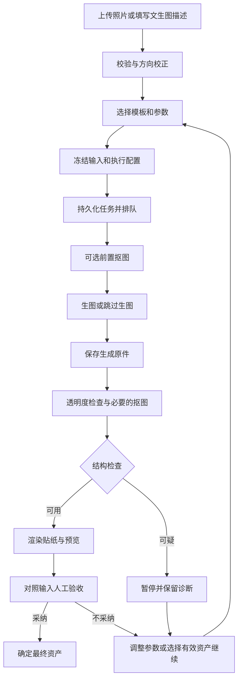

# 成熟生图工作流与持久化设计

日期：2026-09-29。状态：原始设计提案。

**实施范围已收缩为四张业务表**：workflow_job、workflow_step、generation_attempt、image_asset。事件使用日志，验收字段合并到图片表，模板继续使用配置。本次落地能力和限制以 [图片工作流接口](../IMAGE_WORKFLOWS.md) 为准；本文其余部分保留为长期设计参考，不能视为均已实现。

基于设计阶段工作区源码和官方资料审查。下文包含尚未实施的扩展建议；四种数据库的兼容性并未全部验证。

## 1. 建议结论

采用 **Spring Boot 模块化单体 + MyBatis-Plus + H2 文件数据库 + 本地图片存储 + 数据库持久化队列**。

第一版继续使用有限长度的顺序步骤，保留现有 GENERATE、SEGMENT、ENSURE_TRANSPARENCY、STICKER。先完成任务恢复、资产保存、人工验收、失败处理的闭环，再按实际需求增加多候选、蒙版编辑和异步服务商。

成熟度应由以下问题衡量：

- 关掉页面、重启服务后，任务和图片是否还找得到？
- 重复点击、网络超时是否会多次发起收费请求？
- 生图成功但抠图失败，能否只补做抠图？
- 能否说明每张图来自哪张输入、哪版提示词、哪次调用？
- 用户选择的是哪一个结果，是否经过验收？
- 数据库、文件和外部模型三者不同步时，是否能恢复或明确告知未知？

当前阶段不需要把可视化节点编辑器、任意 DAG、消息中间件、分布式工作流引擎作为前置条件。顺序执行也能承载成熟的产品流程。

## 2. 当前项目具有什么基础

| 源码位置 | 已有能力 | 应补齐的边界 |
| --- | --- | --- |
| `workflow/WorkflowService.java` | 参数检查、幂等键与指纹、步骤输出保存 | `Semaphore(1)` 忙时拒绝，没有积压任务队列；状态依赖逐个 `job.json` |
| 同上 `recoverInterrupted()` | 重启时不自动重放云端请求 | QUEUED 与 RUNNING 均被中断，无法区分未发送和可能已计费 |
| 同上 `execute()` | 失败保留前序图片、后续 SKIPPED | 没有独立执行尝试、从失败步骤继续、取消和调用对账 |
| `workflow/Workflow.java` | 执行状态、`requiresReview` | 任务/步骤混用状态枚举；缺少真正的验收记录与采纳结果 |
| `generation/GenerationService.java` | 两种协议、参数拦截、图片校验、usage | 不保存独立 provider request ID；协议判断与请求执行集中在一类 |
| 同上 `prepare()` | 默认参数与请求参数合并 | 执行时再次 prepare，新增默认参数仍可能进入旧任务，快照并未完全冻结 |
| 同上 `providers()` | 暴露配置与模型列表 | 对所有 provider 都声明两种模式，不能当作某个模型的真实能力证明 |
| `generation/BoundedHttp.java` | 超时、响应大小限制、不自动重试 | 未按“未发送／已接受／未知”记录外部副作用 |
| `image/TransparencyService.java` | Alpha 检查、AUTO/FORCE/PRESERVE | 检查结果不是衣物保真证明，应保留人工关口 |
| `static/workflow/app.js` | 提交、轮询、记住最近任务 | 历史依赖一个 localStorage 项，没有服务端任务库、候选和验收入口 |

现有上传入口保存的是方向校正后的 PNG；“原始输入”不等于上传文件的原始字节。新系统需要明确区分两者。

已有测试覆盖幂等、并发拒绝、重启中断、顺序校验和透明度分支。设计升级后，应保留这些约束的意图，并按新队列语义调整“忙时拒绝”的测试。本次仅审查，未执行测试。

## 3. 主流系统值得吸收的做法

以下是官方接口体现的实践；后文是针对当前项目的设计建议，不是照搬某一个平台。

| 参考系统 | 可验证的做法 | 本项目吸收方式 |
| --- | --- | --- |
| ComfyUI | 校验工作流后进入队列，返回标识；提供历史、队列与执行事件 | 保留可序列化步骤定义；提交与执行分离；按步骤展示进度与历史 |
| fal | 持久化异步队列，返回 request ID，可查询状态、取结果、请求取消 | 区分本地任务 ID 和供应商任务 ID；适配器可选择同步或异步协议 |
| Replicate | API 预测数据默认会定期清除，要求自行保存副本 | 收到结果后尽快归档；业务资产不能只保存临时 URL |

资料：[ComfyUI 服务端接口](https://docs.comfy.org/development/comfyui-server/comms_routes)、[fal 异步推理](https://fal.ai/docs/documentation/model-apis/inference/queue)、[Replicate 数据保留](https://replicate.com/docs/topics/predictions/data-retention)。

特别注意：平台内部能够安全重试，不表示本项目对它的提交 POST 也能无条件重试。本地幂等键是否传递到供应商、供应商是否支持并承诺该语义，必须分别验证。

## 4. 面向衣物的产品流程



建议三个模板：

1. **忠实抠图**：校正 → 确保透明 → 贴纸。优先满足衣物原样保留，零生图调用。
2. **轻度整理**：校正 → 可选预抠图 → AI 整理 → 保存生成原件 → 确保透明 → 贴纸 → 人工验收。
3. **创意生成**：描述 → AI 生图 → 确保透明 → 贴纸 → 人工验收。明确它没有真实衣物输入作为保真依据。

预抠图继续默认关闭。轻度整理沿用当前提示词基线，每次修改形成新版本；不自动扩展成强制对称、重建遮挡细节或多轮反复生成。

不要让 AI 自动无限循环“生成—打分—再生成”。后续如加入多候选，显式指定数量和调用上限，每个候选独立记录尝试、成本和验收。输入相同也不能全局去重生图，用户可能正是想要不同结果。

### 人工验收检查点

- 是否还是同一件衣物：版型、领口、袖口、口袋、长度比例。
- 颜色、纹理、印花和文字是否改变。
- 主体是否完整，是否截边、残留背景或丢失细带。
- 透明边缘、半透明面料与贴纸表现是否可接受。

Alpha 指标可以自动计算；文字一致性、颜色差异、语义相似度只能作为后续辅助，不能把一个相似度分数当成保真合格证明。展示“已完成 2/4 步”，不模拟供应商没有提供的生成百分比。

## 5. 模块边界

```text
API / 页面
  └─ WorkflowApplicationService：提交、取消、继续、验收
      ├─ WorkflowValidator：检查输入、步骤关系、能力、预算
      ├─ WorkflowRepository：任务、步骤、尝试和事件
      ├─ WorkflowDispatcher：扫描、领取、租约、恢复
      ├─ StepExecutorRegistry
      │   ├─ GenerationStepExecutor → GenerationProvider
      │   ├─ SegmentationStepExecutor → 现有 SegmentationService
      │   ├─ TransparencyStepExecutor → 现有 TransparencyService
      │   └─ StickerStepExecutor → 现有 StickerRenderer
      ├─ AssetStorage：本地文件读写与完整性验证
      └─ ReviewService：验收、采纳、替代关系

MyBatis-Plus Mapper：持久化实体与通用 SQL
H2：结构化状态和索引
本地 data/assets：图片与受控原始响应
```

避免把现有 `WorkflowService` 简单换成继承 `ServiceImpl` 后继续包办所有职责。工作流转换是业务操作，应由应用服务显式实现；Mapper 专注读取和条件更新。

`GenerationProvider` 区分 `executeSync` 与可选的 `submitAsync/query/cancel`。不支持的能力必须返回明确结果，不能假装取消成功或提供虚假的异步查询。

能力声明按 provider + model 管理：模式、图片数量、蒙版、多参考图、尺寸、输出格式、透明背景参数、异步查询、幂等支持。声明、实测、未知三者分开；不要仅凭模型名推断。未知高级参数可保留受限透传，但不得绕过地址、鉴权、输入和数量限制。

## 6. 状态模型：三件事分开记录

### 6.1 任务状态

| 状态 | 含义 | 后续动作 |
| --- | --- | --- |
| QUEUED | 已持久化，尚未领取 | 领取或取消 |
| RUNNING | 正在执行本地或远程步骤 | 完成、等待远程、失败、暂停或取消请求 |
| WAITING_PROVIDER | 有供应商任务标识，等待远程完成 | 查询、接收回调、取消请求 |
| BLOCKED | 某一步需要人工判断，自动执行暂停 | 选择有效输入派生继续任务，或取消 |
| SUCCEEDED | 所有必需步骤技术上完成 | 独立验收和采纳 |
| FAILED | 已知无法完成 | 按分类重试或派生新任务 |
| CANCEL_REQUESTED | 请求停止，外部执行尚未确认停止 | 确认取消或记录最终结果 |
| CANCELLED | 本地后续执行已停止 | 仍可记录迟到的供应商证据和费用 |
| UNKNOWN | 外部是否接受、完成或计费不能确定 | 对账；不自动重新提交 |

`UNKNOWN` 对自动生图调度而言是停止态，但允许对账后进入已知状态。它不是“永久失败”。

### 6.2 步骤与尝试

步骤描述“做什么”，尝试描述“这一次怎样执行”。每次重试增加 attempt，不覆盖上一次记录。

步骤使用自己的状态集合：PENDING、RUNNING、WAITING_PROVIDER、SUCCEEDED、BLOCKED、FAILED、UNKNOWN、SKIPPED、CANCELLED。步骤只有在输出已归档并被数据库引用后才算成功。

attempt 的 dispatch_state 记录 PREPARED、DISPATCHING、ACKNOWLEDGED、FINISHED、UNKNOWN；其中 DISPATCHING 是发送前持久化的边界标记，重启时保守视为“可能已经发送”。此外独立保存 usage、计费是否未知、供应商 ID、HTTP 状态和可安全展示的错误。

### 6.3 验收状态

review_status：NOT_REQUIRED、PENDING、APPROVED、REJECTED。

`SUCCEEDED + PENDING` 表示图做出来了，尚未被用户认可。验收必须绑定具体资产及其哈希；换图或重试后不能沿用旧图的 APPROVED。技术失败的流程也可能产生可用中间图，用户可以选择该图派生任务或验收该资产，但不把失败流程改写成成功。

现有 `NEEDS_REVIEW` 是停止后跳过余下步骤的终态。兼容层需要明确映射成 BLOCKED，而 `requiresReview=true` 只表示需要验收，不能推断用户已验收。

## 7. 数据模型

### 7.1 第一阶段核心表

| 表 | 主要字段 | 关键约束 |
| --- | --- | --- |
| `wf_job` | id、scope_id、idempotency_key、request_hash、hash_version、status、definition_version、request_json、resolved_json、input_asset_id、output_asset_id、parent_job_id、source_step_id、created_at_ms、updated_at_ms、next_run_at_ms、lease_owner、lease_token、lease_until_ms、version、cancel_requested_at_ms、error_code | UNIQUE(scope_id, idempotency_key)；状态/调度时间索引；创建时间/id 索引 |
| `wf_step` | id、job_id、step_no、step_type、status、spec_json、input_asset_id、output_asset_id、selected_attempt_id、version | UNIQUE(job_id, step_no) |
| `wf_attempt` | id、step_id、attempt_no、execution_status、dispatch_state、provider_id、model_id、provider_request_id、provider_config_revision、resolved_request_json、started_at_ms、finished_at_ms、usage_json、billing_status、error_code、http_status、lease_token | UNIQUE(step_id, attempt_no)；provider/request ID 查询索引；同一步只允许一个被领取的活动尝试 |
| `image_asset` | id、storage_key、sha256、mime_type、byte_size、width、height、alpha_summary_json、asset_kind、asset_status、created_at_ms、producer_attempt_id | storage_key 唯一；哈希用于校验，不默认跨用户合并图片 |
| `wf_event` | id、job_id、step_id、attempt_id、event_type、payload_json、created_at_ms、event_seq | UNIQUE(job_id, event_seq)；每次状态更新同事务写事件 |
| `asset_review` | id、asset_id、asset_sha256、job_id、decision、reason、actor、created_at_ms | 追加记录；采纳变更保留历史 |

表名使用小写下划线，避免 `order`、`user` 等常见保留字。外键采用 RESTRICT 思路，不对任务—图片做隐式级联删除。

第一版 scope_id 可固定为 `local`，它只是幂等命名空间，不代表已经具备身份认证或租户隔离。将来暴露到公网时，资产、任务、查询与引用必须一起做权限校验。

`wf_job` 作为汇总状态，`wf_step/wf_attempt` 保存细节，`wf_event` 支持审计和事件重放展示；它不是要求整个系统改为 event sourcing。任务、步骤、尝试和对应事件的关键转换放进一个短事务。

第一版每步单输入/单输出，用字段即可。以后多参考图、多候选输出时，增加 `wf_step_asset(step_id, attempt_id, asset_id, role, ordinal)` 关系表，避免往单个字段拼接 ID。

### 7.2 模板与提示词版本

第一版可以使用随代码版本发布的模板文件，任务保存模板 ID、版本和完整解析快照。出现在线编辑模板需求后，再增加 `wf_template`、`wf_template_version`；不必立即做模板管理平台。

快照至少保存：输入资产哈希、最终 prompt、合并后的参数、provider/model/protocol、适配器版本、模型文件哈希、透明度规则版本、贴纸参数、应用版本。密钥不进入快照；配置只保存无密钥引用和修订号。

执行时只校验快照，不再次合并当前默认参数。配置已失效、供应商已删除时明确阻止执行；不要偷偷切换供应商或模型。即使保存 seed，也只能承诺过程可追溯，不能保证云模型升级后逐像素复现。

## 8. MyBatis-Plus 与跨数据库策略

### 8.1 依赖与 H2 模式

项目当前是 Spring Boot 4.1.1 / Java 21。MyBatis-Plus 官方提供 `mybatis-plus-spring-boot4-starter`，应选与现有 Boot 版本验证兼容的组合，避免误用 Boot 3 starter 或重复引入 MyBatis starter。本次查询官方示例为 3.5.17；实际实施时固定版本并执行启动与 Mapper 集成测试。[官方安装说明](https://baomidou.com/getting-started/install/)

H2 使用文件模式，例如 `jdbc:h2:file:./data/db/closet`；测试用隔离的内存库和临时文件库。正式使用标准 H2 模式，不靠 MySQL 兼容模式掩盖不可移植 SQL。H2 支持文件数据库，但文件存在不等于备份已一致，应设计数据库与资产一起恢复的备份流程。[H2 文档](https://h2database.com/html/features.html)

### 8.2 数据类型约定

| 概念 | 推荐表示 | 理由与限制 |
| --- | --- | --- |
| ID | 应用生成的小写 UUID 字符串，VARCHAR(36) | 避免自增、序列和原生 UUID 类型差异 |
| 时间 | UTC epoch milliseconds，BIGINT；API 输出 ISO-8601 | 避免数据库时区和时间函数差异 |
| 状态 | VARCHAR(32)，Java 枚举与转换校验 | 避免原生 ENUM |
| 布尔 | SMALLINT/INTEGER 的 0/1，统一 TypeHandler | 避免 JDBC 对布尔映射的差异 |
| 快照与扩展数据 | 大文本中的 JSON，Java 序列化 | 不依赖 JSONB/JSON_EXTRACT 查询 |
| 图片 | 文件系统/对象存储，DB 只记元数据和 storage_key | 便于备份、下载和未来换存储 |
| 金额 | 明确币种、单位与精度；整数最小核算单位 | 不用 double；无法精确换算时保留供应商原始值 |

大文本的 DDL 类型（如 CLOB/TEXT/LONGTEXT）、索引长度、SQLite 的 ALTER TABLE 与连接初始化仍有差异。应把差异限制在迁移脚本、JDBC 配置和 TypeHandler 中；不能承诺换 JDBC URL 即迁移完成。

状态、provider、时间、错误分类等需要筛选的字段必须独立成列。不要把整个 `job.json` 原封不动放进一列后，所有任务列表继续在 Java 内存里过滤。

### 8.3 查询与更新

- 常规 CRUD 使用 BaseMapper 和 LambdaQueryWrapper；复杂汇总允许小而明确的通用 SQL。
- 分页交给 MyBatis-Plus PaginationInnerInterceptor；固定排序和最大页尺寸。其文档列出 H2、SQLite、PostgreSQL、MySQL，并要求按版本引入分页解析依赖。[分页插件](https://baomidou.com/en/plugins/pagination/)
- 不使用手写 `last("limit ...")`、数据库 JSON 操作、原生 UPSERT、厂商时间函数或 `SKIP LOCKED` 作为业务正确性的基础。
- 幂等依赖 UNIQUE；捕获唯一约束冲突后，在新事务读取既有记录。不要在 PostgreSQL 已因约束异常失效的事务中继续查询。
- 状态转换使用带旧状态、version 和 lease_token 的条件 UPDATE，并检查影响行数为 1。不要先查状态后无条件 `updateById`。
- 乐观锁插件可辅助 CRUD，但不能代替领取和状态机的显式条件。
- 可复现排序使用 `(created_at_ms, id)`；动态排序字段由后端白名单映射。无必要时不依赖各库 NULL 排序差异。

### 8.4 数据库迁移与兼容级别

从第一版建立版本化 schema migration。可采用 Flyway 等成熟迁移器，但选定版本对四种数据库及驱动的支持必须实测；SQLite 升级中需要重建表时允许单独脚本。避免上线后依靠一份 `CREATE TABLE IF NOT EXISTS` 自动“补结构”。

建议分级声明：H2 为当前运行目标；SQLite 为下一步嵌入式兼容目标；PostgreSQL/MySQL 在真实数据库测试通过前标记“设计支持，尚未验证”。H2 的兼容模式不能替代后两者测试。

SQLite 即便使用 WAL 也只有一个并发写入者。因此短事务、有限连接和有界锁等待非常重要，连接池变大并不会增加写吞吐。WAL、busy timeout、外键初始化等放在 SQLite 配置层，不能混入通用 Mapper。[SQLite 隔离文档](https://www.sqlite.org/isolation.html)、[WAL 文档](https://www.sqlite.org/wal.html)

## 9. 持久化队列和执行恢复

### 提交顺序

1. 校验文件大小、解码像素、步骤关系、模型参数和运行上限。
2. 把输入保存为不可变资产，完成哈希和持久化检查；最终路径由服务端生成。
3. 在短事务中插入 job、steps、输入资产引用与首个事件，提交后返回 202。
4. worker 从数据库扫描 QUEUED 且到执行时间的任务，领取后执行。内存唤醒只作提速，漏掉唤醒不丢任务。

输入文件先写完、数据库后提交，可能留下孤立文件，但不会把未写完的输入交给 worker。孤立文件通过宽限期后的对账清理处理。

### 领取算法

先分页读取候选，再执行类似以下通用条件更新：

```sql
UPDATE wf_job
SET status = 'RUNNING', lease_owner = ?, lease_token = ?,
    lease_until_ms = ?, version = version + 1
WHERE id = ? AND status = 'QUEUED' AND version = ?;
```

影响 1 行才有执行权。每次领取生成新 lease_token，续租和提交结果也校验 token，防止旧 worker 在失去租约后覆盖新状态。此 SQL 是设计示例，实施时补齐取消/调度条件并做竞争测试。

网络请求、图片解码、模型推理、文件写入都在数据库事务外。数据库只保护“领取”和“记录结果”等短动作。

### 执行与恢复规则

- QUEUED：重启后继续扫描，不再统一判为 INTERRUPTED。
- 本地步骤租约过期：确认旧执行权失效后可新建 attempt；输出路径按 attempt 区分，旧结果不能覆盖新结果。
- 远程步骤尚在 PREPARED，能够确认没有进入发送边界：可继续。
- 已有 provider request ID：先查询原调用；恢复的是查询，不是重新提交。
- DISPATCHING 或等待同步响应时进程退出：进入 UNKNOWN，禁止自动重放收费调用。
- 已得到并可靠归档结果：补记数据库引用或继续后处理，避免重新生图。

租约只防止本地状态竞争，无法撤回已经到达供应商的 HTTP 请求。**没有供应商幂等或查询协议时，数据库不能提供外部生图的 exactly-once 保证。** 即使发送前写记录，也存在“记录完成但尚未发送”和“已发送但未记响应”之间无法完全判定的窗口。

第一版采用单进程部署，云端生图并发默认 1，本地 CPU 推理独立限流，积压任务有数量上限。队列满才返回 429，并提供可解释的重试时间；同幂等键查询已有任务不能因为队列满被拒绝。将来多进程时，还需解决全局配额和租约时钟误差，不把进程内 Semaphore 当全局限流。

## 10. 幂等、重试、取消和费用

### 幂等的三个层次

1. **提交幂等**：scope + key 相同且请求相同，返回原任务；内容不同返回 409。
2. **执行尝试**：同一步重试形成新 attempt，每个 attempt 有自己的执行标识。
3. **供应商幂等**：仅在供应商明确支持时使用，记录有效期和作用范围；不能假定传一个 header 就生效。

新接口要求提交携带 key，并提供按 key 查询任务的入口，因为新设计 job ID 不再必须等于 key。提交响应丢失时先查询或用同 key 原请求重发。旧接口保留既有 ID/key 语义作为兼容适配。

请求哈希采用版本化规范序列化：对象键排序、约定缺省值、保留数组顺序、拒绝 NaN 等无效数值，输入引用不可变 asset ID/哈希。用户意图的 request_hash 与最终执行配置的 resolved_hash 分开：更新默认参数不应让已受理的同 key 请求变成另一项任务。相同意图的新 key 仍可创建新候选。

### 重试决策

| 情况 | 默认处理 |
| --- | --- |
| 本地处理临时失败 | 有界重试；永久输入错误直接失败 |
| 查询供应商状态失败 | 退避并加随机抖动，可重试，不重新提交 |
| 401/403、参数错误、不支持的能力 | 失败并要求修正配置/请求 |
| 429 | 只有已确认未受理且该供应商允许安全重试时，遵守 Retry-After |
| 502/503/504、读超时、发送中断 | 不仅凭状态码判断未计费；不确定时 UNKNOWN |
| 供应商已完成，结果下载失败 | 重试下载或查询同一结果，不能重试生图 |
| 生图完成，透明度检查/贴纸失败 | 复用已保存的生成资产，只运行后续步骤 |
| 用户不喜欢已生成结果 | 派生新任务，是新的生成，不伪装成网络重试 |

重试上限按本地处理、下载、查询、生成分别配置，使用 next_run_at 调度退避，避免 worker 长时间 sleep。

### 取消

排队任务可直接取消；本地处理中在安全点停止；远程处理中先记 CANCEL_REQUESTED，支持远程取消才调用相应接口。没有远程取消能力时停止本地后续步骤，并清楚显示“远程可能仍在执行或计费”。

取消与结果同时到达时，用条件更新决定转换，不把 CANCELLED 自动变成 SUCCEEDED。迟到结果可归档并记录事件，但不能自动继续后处理或采纳。关闭页面不等于取消。

### 成本

每个 attempt 保存原始 usage、预计费用、确认费用、币种和计费状态；供应商未给出费用时显示未知，不能当作零。开始新的收费尝试前检查调用数和预算；存在 UNKNOWN 时占用保守预算，直至对账。额度控制只限制后续提交，不能保证停止已在云端执行的费用。

## 11. 图片资产与文件/数据库一致性

资产按用途区分：UPLOAD_ORIGINAL、NORMALIZED_INPUT、GENERATED_ORIGINAL、MASK、CUTOUT、STICKER、THUMBNAIL。原始文件是否长期保留需有明确策略；保存时按非公开资产处理，预览/导出使用去除不必要元数据的派生图。

图片不可变。新版本有新 asset ID，不覆盖旧图；后续输入引用 asset ID，不能只引用“某任务当前输出”。多图编辑时还需记录参考图顺序、蒙版坐标系及对齐关系。

### 输出提交协议

1. attempt 预先分配输出 storage_key，在同一文件系统的暂存区写入。
2. 检查长度、哈希和可解码性；保存小型 manifest，记录 attempt ID、哈希、用途。
3. 完成文件持久化后原子移动到最终路径。原子重命名只保证可见性，不自动保证断电持久性；具体刷盘策略由存储实现定义。
4. 短事务插入 READY 资产、更新 attempt/step/job 并写事件。
5. 对账扫描处理中断的 manifest、无引用文件以及文件缺失的资产；恢复、隔离或告警，不能静默当成功。

若步骤 3 后崩溃而步骤 4 未完成，凭 manifest 与哈希可以恢复关联；无法证明归属的文件隔离，不自动认领。未来对象存储没有本地原子 rename，AssetStorage 应用不同的上传与发布实现，业务流程继续只消费 READY 资产。

生成输出优先保留服务商图片原件，再生成规范 PNG。临时下载 URL 在受控字段保存并尽快归档，不写进可公开日志。下载失败属于结果获取失败；URL 过期且上游无法取回时明确标记结果丢失，不能悄悄再生成一张替代。

保留现有响应体、字节、像素大小限制、可信域名限制、无重定向、下载不带密钥等措施。公网部署还需出口网络约束；DNS 检查本身不能替代网络隔离。不要允许用户指定任意本地路径或任意下载 URL。

删除分两步：先取消引用/标记待删，确认没有活动任务或已采纳结果引用，再物理删除。幂等记录保留期应独立于图片保留期，避免清理图片后同 key 意外重新生图。数据库与资产备份必须有共同恢复边界，第一版可短暂停止写入后备份，并验证恢复。

## 12. API 与页面变化

新语义建议放到 `/api/v2`，保留现有接口供旧页面过渡。以下是设计契约：

| 接口 | 用途 |
| --- | --- |
| `POST /api/v2/assets` | 上传、校验、登记输入资产 |
| `POST /api/v2/workflows` | 携带幂等键提交；事务提交后返回 202 与 job ID |
| `GET /api/v2/workflows/by-key/{key}` | 在当前 scope 查找提交结果，处理响应丢失 |
| `GET /api/v2/workflows` | 按时间、状态、模板筛选分页 |
| `GET /api/v2/workflows/{id}` | 当前汇总、步骤、可执行操作 |
| `GET /api/v2/workflows/{id}/events` | 游标查询事件；以后可加 SSE |
| `POST /api/v2/workflows/{id}/cancel` | 幂等取消请求 |
| `POST /api/v2/workflows/{id}/continue` | 引用已保存资产和明确起点，派生新任务 |
| `POST /api/v2/assets/{id}/reviews` | 对具体图片验收、记录理由 |
| `GET /api/v2/assets/{id}/content` | 从 READY 资产下载，不暴露磁盘路径 |

continue 返回新 job ID，保存 parent_job_id 和 source_step_id，原任务保持原始失败/阻塞历史。起点可以是抠图、透明度检查或贴纸；修改上游生成参数必须新建生成分支，不能继续引用旧下游为有效结果。

有副作用的继续、验收、采纳操作也应有幂等或版本条件，避免双击产生重复分支/冲突采纳。分页列表只带摘要和缩略图链接，不返回整批 prompt、原始响应和所有步骤 JSON。

页面按四个区域组织：输入与模板、运行任务、历史结果、对照验收。默认使用退避轮询即可；断线恢复靠服务端查询，SSE 只是体验改进。提示“生成完成，待确认”“调用结果未知”“已停止后续步骤”应与后端真实语义一致。

## 13. 旧数据迁移

1. 在副本上先做只读扫描，列出 `data/workflows/*/job.json`、步骤文件、分割结果、缺失与损坏项。
2. 备份；迁移窗口暂停旧服务写入，避免扫描期间记录变化。
3. 保留旧 UUID 和旧指纹算法标识，导入 job、step 和现有资产引用；迁移记录以旧 ID 唯一，可重复执行。
4. 旧调用缺少 attempt/request ID 时标记为 LEGACY_IMPORT，不能补造供应商响应或计费数据。
5. 旧 `SUCCEEDED + requiresReview` 导入为待验收；旧 NEEDS_REVIEW 导入为阻塞。旧 RUNNING/INTERRUPTED 含云端不确定执行时按 UNKNOWN 保守处理；不能只凭旧 FAILED 就断言未计费。
6. 校验数量、状态、URL 对应、文件哈希、缺失项，逐项输出迁移报告；坏记录隔离，不阻断所有好记录。
7. 切换数据库为唯一状态来源；旧文件保留只读备份。旧 URL 通过映射继续访问，不同时维护两套可写状态。

如果新服务已经创建任务，回退不能只替换程序二进制；必须恢复一致的数据库/文件备份或提供反向迁移方案。禁止带着新版本状态启动不理解该 schema 的旧程序。

## 14. 分阶段交付与验收

### 第一阶段：持久化与可靠执行

引入 MyBatis-Plus/H2 文件库、版本化 schema、六张核心表、资产存储接口、顺序 dispatcher、独立 attempt、UNKNOWN 分类、任务列表、旧数据导入。暂时保留一条云端执行通道和当前步骤上限。

验收重点：

- 同 key 并发提交只创建一个 job，模拟供应商收到的生成请求数量符合预期。
- 同 key 不同内容返回 409；提交响应丢失后恢复同一任务。
- QUEUED 在进程重启后可以执行；发送窗口退出后不自动重新生图。
- 文件写完但 DB 提交前崩溃，可以恢复或报告明确的待处理记录。
- 列表、分页、取消竞争和状态条件更新行为可验证。
- 未引入真实供应商调用时，使用 stub 测试计费边界，不消耗生成额度。

### 第二阶段：完整操作闭环

增加从已完成步骤派生继续、资产验收与采纳、提示词/模板版本展示、并排对照、成本与调用次数展示、取消交互、备份和保留策略。

验收重点：生成成功后模拟抠图失败，继续操作只运行抠图及后续步骤；被拒绝的结果仍有记录；旧图的批准不继承到新图；取消后的迟到响应不自动继续。

### 第三阶段：按实际需求扩展

多候选、多图/蒙版编辑、异步 provider、webhook、SQLite/PostgreSQL/MySQL 实际兼容验证，以及必要时的多 worker。

webhook 到来前必须有签名验证、重复与乱序处理、事件幂等、与轮询的竞争保护；收到回调不直接相信其下载 URL。多 worker 在真实负载需要时再增加，首先确定全局配额和供应商幂等能力。

### 数据库兼容验收矩阵

四种数据库应执行同一套 Repository 契约测试：建库与升级、长中文 prompt/emoji 往返、时间精度、唯一约束冲突后的恢复、并发领取、版本冲突、分页排序、外键约束和事务回滚。SQLite 额外验证锁冲突与连接设置；H2 额外验证文件库重启；PostgreSQL/MySQL 使用真实目标版本。

H2 通过不等于四库通过；Stub API 通过不等于真实生成质量通过；自动 Alpha 检查通过不等于衣物保真通过。

## 15. 最优先的设计决定

1. 把 job、step、attempt、asset、review 分开，不再用单个状态表示所有事情。
2. 数据库是任务状态来源，文件是不可变资产；两者通过提交协议与对账恢复保持一致。
3. 将“可能已经发送的收费调用”视作独立问题，UNKNOWN 不能被通用自动重试吞掉。
4. 保留小而清楚的顺序执行模型，把当前代码已有的保护做成可持久化、可验证的机制。
5. 通过通用业务 SQL、少量数据库适配和真实契约测试实现可迁移性。
