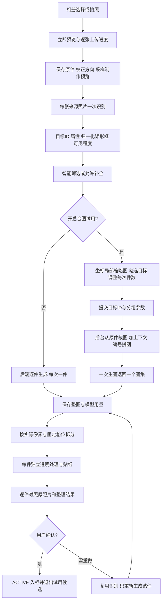

# 鱼搭衣物入库：当前完整设计与实现

版本：2026-10-03；范围：当前 Vue 前端与 Spring Boot 后端的衣物录入、候选选择、合图试用、后处理和入柜。本文以代码实现为准，是本流程的主设计文档；早期方案及阶段报告用于追踪设计演进，不覆盖本文所述当前行为。

对应项目：前端 `smart-closet`，后端 `smart-closet-server`。所有可见交互使用 Ant Design Vue，沿用鱼搭主题、音效与移动端导航。本文记录现有实现，同时明确尚未解决的边界；“设计目标”不等于已经通过真实模型质量验收。

## 1. 产品目标与当前决策

录入的目标是让照片中的真实衣物成为用户确认过、可以放进衣柜卡片和穿搭画板的资产。优先降低操作负担、保留可见细节，并减少重复识别与无意义返工。云端请求成功、文件写入成功、贴纸生成成功都不能替代用户的逐件核对。

当前主流程是“选照片 → 自动整理 → 核对入柜”。默认使用多目标识别能力与智能自动策略，用户无需先判断照片属于单件、多件同框还是自拍。单件照片、多件同框、自拍、镜子照及多张照片统一从此入口进入。

后台仍保留 SINGLE / MULTIPLE 两种通道契约；当前主界面上传固定提交 MULTIPLE。SINGLE 是兼容与接口能力，不是当前主界面的必选开关。不得再把早期“用户必须先选单件/多件、默认单件”的方案解释为当前产品。

普通录入默认逐件生成。合图是用户明确开启的试用功能，不因为上传了一张多衣物照片就自动出现必须选择的合图步骤。开启后先完成识别，再由用户决定目标和每次件数；未开启时后端自动衔接识别与逐件生成，用户不必停留在页面。

整理、核对和入柜是三个不同事实：

| 事实 | 含义 | 能否视为已入柜 |
| --- | --- | --- |
| 识别完成 | 找到了目标、位置与可见属性 | 否 |
| 整理图已返回 | 云端返回了生成图片 | 否 |
| 本地处理完成或待核对 | 已有独立结果，可能仍需检查透明边缘与贴纸 | 否 |
| 用户确认入柜 | 指定资产及元信息通过确认，衣物状态为 ACTIVE | 是 |

## 2. 术语与身份关系

| 名称 | 含义 | 稳定标识或关联 |
| --- | --- | --- |
| 来源照片 Source | 用户上传的一张照片，可含多件衣物 | sourceId、原件与预览哈希 |
| 批次 Batch | 一次录入会话，最多十张来源照片 | batchId、owner_username |
| 候选目标 Target | 来源照片中的一件可分别收录的衣物 | targetId、sourceId、bounds |
| 衣物档案 Garment | 此目标进入现有衣柜体系的记录 | garmentId，创建目标时与 targetId 相同 |
| 调用 Call | 一次云端识别或生成的持久化记录 | callId、冻结请求、用量与结果 |
| 生成分组 | 一次生图请求处理的实际目标列表 | 有序 targetIds，长度不超过 groupSize |
| 输入参考图 Reference | 后台裁出的目标区域按编号拼成的图 | reference-{callId}.png |
| 输出图集 Atlas | 一次生图返回的整张精灵图 | atlas-{callId}.png |
| 格位 Slot | 某个生成分组中目标的行列位置 | 目标列表下标；内部 slot 从 0 开始 |
| 独立工作流 Job | 拆出单件后进入现有透明/贴纸流程的任务 | 根据 callId 与 targetId 生成的稳定 jobId |
| 用户可见编号 | 原批次目标序号，便于选择与结果对照 | #1、#2……，不随过滤已入柜目标而重新编号 |

用户可见编号和本次合图格位不是同一个编号。例如只选择原批次的 #7、#9，仍显示 #7、#9，但它们在本次生成中分别是第 1 格、第 2 格。后台绑定依赖 UUID 与冻结目标顺序，而不是靠衣物中文描述或列表当前显示位置猜测。

衣物的生成任务状态与 `confirmed` 字段分开返回。`confirmed` 每次读取时根据当前账号的 garment.closet_status=ACTIVE 计算，不能用“任务成功”或“批次已入柜总数”代替逐件入柜状态。

## 3. 完整数据流



云端识别、云端生成与本地后处理分开记录。用户离开页面不取消已持久化的云端任务；前端轮询是展示进度，不是任务执行的驱动力。

## 4. 入口、相机与上传体验

### 4.1 主入口

`/add` 默认展示批次录入，`/batches/{batchId}` 恢复已有批次。主界面提供选照片、拍照、可选合图试用，以及渐进展开的遮挡/指定目标策略。

传统“仅识别”和“本地去背景、自己填写”保留在工具入口中；这些是独立用途，不要求普通用户先理解所有技术选项。模型提供者与模型配置沿用后台提供的处理选项，主批次界面不把模型参数作为录入的首要选择。

### 4.2 手机与桌面拍照

手机支持浏览器原生相机文件入口，前置/后置入口分别使用 capture=user/environment 提示。capture 是浏览器提示，具体行为由浏览器和设备决定。

具备 MediaDevices 的设备可使用 CameraCapture。检测相机只枚举设备，不为了检测而触发权限请求；实际打开时调用 getUserMedia，使用 facingMode 的 ideal 约束且不请求音频。关闭或卸载时停止视频流。抓拍转成 JPEG 文件后进入与相册一致的上传逻辑。

权限拒绝、无相机、设备占用、打开失败都有可理解的提示，并保留“从相册选择”路径。不得将相机故障解释为照片本身不合格。

### 4.3 立即预览与逐张上传

选择文件后通过 Object URL 立即显示本地预览。移除、页面卸载时释放 URL。文件按来源照片逐张上传，每个上传请求只含一张照片及必要 JSON 参数，不把十张原图放进一个 500MB 的请求。

前端展示当前上传第几张与该张进度；通过 XHR 的上传事件计算百分比。进度只表示网络上传，不表示识别、生图或后处理完成。

上传中断后，已成功保存的照片留在后台；仍在当前页面时可继续上传未完成照片。页面彻底关闭后，未上传的本地文件不能凭 Object URL 恢复，需重新选择；后台已经保存的来源、目标、任务可以恢复。

开始识别后不能向原批次追加照片，避免目标集合、配额与冻结任务混在一起。新增照片需新建批次。

## 5. 图片上限、原件和处理副本

### 5.1 上传校验

| 项目 | 当前限制 | 处理位置 |
| --- | --- | --- |
| 每批来源照片 | 最多 10 张 | 前端与后台 |
| 原件格式 | JPEG / PNG | 文件选择提示、后台真实解码 |
| 单张字节数 | 非空且不超过 50×1024×1024 字节 | 后台与前端初筛 |
| 原件宽高 | 每边至少 32、最多 16384 像素 | 后台读头 |
| 原件总像素 | 不超过 64,000,000 | 后台读头 |
| Servlet 单文件/请求限制 | 50MB / 51MB | application.yml |
| HEIC | 不直接支持 | 提示先转 JPEG；相机导出的 JPEG 可上传 |

界面中的“50 MB”是用户友好文案；业务字节校验按 50MiB 实现。文件扩展名和 MIME 只做前端初筛，后台使用 ImageIO reader 判断真实格式和尺寸。

服务端先读取图片头，检查原尺寸，再使用采样解码，避免先完整展开几千万像素。采样步长为 ceil(最长边/maxSide)，实际副本可能小于上限；不能假定副本一定恰好是 1600 像素。

EXIF 方向应用到处理副本。模型坐标、界面预览及后台裁图均以校正方向后的图像为基准。原件字节保留，不能为了改变方向覆盖原件。

### 5.2 三类不同用途

| 资产 | 来源 | 当前用途 |
| --- | --- | --- |
| 原件 | 用户上传原始字节 | 细节追溯、重新裁图、原图对照 |
| 预览/识别副本 | 原件采样并校正方向，最长边不超过 1600 | 页面预览、首次批次识别 |
| 生成参考 | 从原件重新采样后按目标矩形裁切，再编号合图 | 给生图模型定位具体目标 |
| 图集输出 | 云端返回整图 | 失败恢复及拆分来源 |
| 单件生成图 | 按格切出的独立 PNG | 透明处理和贴纸输入 |
| 本地后处理资产 | 透明检查、抠图、贴纸结果 | 核对、衣柜卡片、画板 |

当前相册上传不会统一在前端压缩所有原件；网络上传的是原文件。控制模型输入尺寸主要在服务端完成。抓拍生成 JPEG 属于相机采集输出，不能把它说成所有相册文件都会前端统一压缩。

穿着照在识别前、裁图前不先做本地去背景。通用前景模型不是衣物语义分割，提前抠图可能把人物一起保留，也可能损伤衣物关键细节。

## 6. 识图返回内容与坐标含义

### 6.1 每张来源照片一次请求

一个多衣物同框图通过一次识别返回多件候选；不是每件候选重复调用一次识别。多张单件照仍是每张来源照片一次识别，当前没有把多张照片先合成识别输入。

每张来源最多返回 10 个 items。MULTIPLE 列出可分别辨认的目标；SINGLE 只接受一个主目标。手动模式中没有任何标记的来源照片本地跳过，不占识别额度。

每个有效 item 包含：

```json
{
  "markerIndex": -1,
  "visibleFraction": 0.92,
  "keyDetailsVisible": true,
  "reason": "主体完整，领口和图案可见",
  "result": {
    "assessment": "READY",
    "target": {
      "description": "画面中央的蓝色短袖V领连衣裙",
      "worn": false,
      "bounds": {"x": 0.35, "y": 0.28, "width": 0.22, "height": 0.5}
    },
    "attributes": "实际响应为完整16字段对象，见下文",
    "issues": []
  }
}
```

上例用于解释字段；attributes 的字符串是文档占位说明，不是可提交的实际合法响应。真实模型回答必须包含完整属性对象，后台不接受此占位值。

### 6.2 bounds 是估计矩形，不是精准轮廓

x/y 是左上角，width/height 是宽高，均是 0～1 的归一化坐标。位置相对于校正方向后的来源图。矩形必须宽高大于零，且 x+width、y+height 不超过图片边界（浮点误差容许至 1.000001）。

模型给出的矩形框用于定位与裁参考图，不能解释为像素级分割结果，也不能承诺框内只有该件衣物。同框重叠、宽松外套、裙摆或手持物体可能使矩形包含邻件、人物或背景。

模型坐标经过数值、边界和必要手动标记校验；这些检查证明结构合法，不证明视觉定位一定准确。原图对照和候选缩略图承担可见校验入口。

### 6.3 属性与目标合并识别

首次识别同时返回目标位置、可见程度与元信息，后续生成和单件返工复用这些结果。不是生成完成后再为每件重新发一次云端元信息识别。

现有 16 个属性为：品类 category、主色 primaryColor、辅色 secondaryColors、图案 patterns、领型 neckline、袖长 sleeveLength、衣物长度 garmentLength、门襟 closure、表面纹理 texture、风格建议 styles、季节建议 seasons、品牌 brand、尺码 size、成分 materialComposition、洗护 careInstructions、可见文字 visibleText。

属性状态包括 OBSERVED、INFERRED、UNKNOWN、NOT_APPLICABLE、CONFLICT。风格和季节有值时只能 INFERRED；其他字段不得使用 INFERRED。后三种无明确值状态必须 values=[]。有值字段提供依据，无值字段说明原因；不能把胸前印字当品牌证据，不能补写看不清的文字、品牌或衣标。

品类、主色、领型、袖长、长度及品牌/尺码/成分/洗护最多一个值，其余最多十二个值。属性值是开放文本，常见选项是建议而非硬枚举。后台仍校验数量、重复、空值、状态与品类语义；例如下装不能同时填写领型和袖长。

### 6.4 识别异常诊断

模型拒绝、JSON 非法、响应截断、结构不符、语义冲突分别处理，不把任意失败都当作“图片太大”。字段语义错误会指出校验所在字段或区域。

收到可解析模型回答后，将原始 JSON 保存为 recognition-{callId}.json，再做目标校验，以便查清付费响应为什么被拒绝。此 JSON 是后台诊断文件，未加入公开图片查询白名单；图片接口不直接暴露该文件。

旧版本失败调用如果没有保存原始回答，无法通过现有日志凭空恢复具体字段。原始响应的持久化从加入此机制后的新调用生效。

## 7. 三种策略与补全边界

| 策略 | 候选返回 | 实际可整理条件 | 补全规则 |
| --- | --- | --- | --- |
| SMART 智能自动（默认） | 可辨认但不完整的目标也可返回 | visibleFraction≥0.8 且 keyDetailsVisible=true | 禁止凭空补出不可见结构、文字或图案 |
| FULL 全自动 | 所有可辨认目标 | 不使用 80% 门槛 | 可合理补全遮挡和缺失部分，可见细节必须保持 |
| MANUAL 手动标记 | 仅返回用户点击的可辨认目标 | 不使用 80% 门槛，必须正确匹配标记 | 与全自动一样允许补全，并提示尽量标完整衣物 |

visibleFraction 是衣物完整外观实际可见比例的近似值，不是识别置信度，也不是框占原图的面积。keyDetailsVisible 表示关键可见细节是否辨认得出。折叠、遮挡、出画都可以降低可见程度。

手动标记保存在校正方向的照片坐标中。点击计算考虑图片 contain 显示后的留白，点击留白不产生有效标记。键盘入口可用中心点作为标记起点。后台要求模型返回 markerIndex，目标框必须覆盖对应点（边界判断带 0.03 容差），并拒绝重复标记匹配或自动模式携带手动索引。

SINGLE 每张最多一个标记；界面每批最多十个标记。没有标记的来源照片不产生识别付费调用。标记在不可辨对象上不能强行猜衣物。

补全标记条件：非 SMART，且 visibleFraction<0.99、关键细节不可见或 assessment=PARTIAL。整理结果、溯源和元信息问题列表保留补全提示。补全是推测，不能拿隐藏细节的“好看”替代保真。

SMART 跳过项继续保留描述和原因，可以对照原图、补拍；不把它混入生成目标来凑满一张精灵图。

## 8. 候选选择：坐标缩略图与选择生命周期

### 8.1 选择列表如何显示主视衣物

多衣物选择列表使用 BatchTargetPreview，根据 target.recognition.target.bounds 在来源预览图中显示对应局部区域。它使用的是校正方向后的 previewUrl，不是生成结果缩略图。

当前实现是前端 CSS 视窗：64×64 像素容器，overflow:hidden；图片以绝对位置放大和偏移，尺寸与偏移根据归一化框计算：

```text
图片显示宽度 = 100 / bounds.width 百分比
图片显示高度 = 100 / bounds.height 百分比
left = -100 × bounds.x / bounds.width 百分比
top  = -100 × bounds.y / bounds.height 百分比
```

这会把矩形内区域映射到方形视窗，可能改变展示比例；仅用于快速识别候选，不创建新的图片文件，也不改变后台生成参考。这里不添加后台的 2.5% 上下文边距。矩形里如果有邻近衣物或背景，界面仍会显示它们。

结果卡在整理图旁继续显示同一来源局部缩略图与原批次编号，便于“这张结果究竟是哪件”的对照。结果资产与来源局部预览分别保留，不用一张缩略图兼任两个含义。

### 8.2 可选目标与已入柜过滤

可选目标 = 策略允许整理的目标，且 confirmed=false。已入柜衣物显示在结果区并标注“已入柜”，但退出合图候选，隐藏批次里的再次入柜/重做按钮。

后台提交也检查逐件入柜状态。用户停留在旧页面、另一个设备已经确认、或直接调用接口时，已入柜目标不能因为前端旧数据而再次进入合图；拒绝发生在额度预留之前。

需要修改已入柜衣物应从衣柜打开该衣物，沿用详情页的编辑/重做流程。不能把试用候选列表当作任意批量改写已入柜资产的入口。

### 8.3 选择与滑块

试用默认不勾选目标，每次件数初始为 2，并按实际可选数量限制。滑块范围为 1～min(10,可选目标数)；无候选或只有一件时禁用滑动。每次件数是上限，不要求选中数为其整数倍。

“只选一组”是用户明确要求选当前列表前 groupSize 个可选目标的快捷操作；“选全部”选当前所有可选目标。除此之外，调整滑块不自动勾选，不改变用户手动勾选集合。

选中项显示“第几组、第几格”；分组顺序按照原候选顺序，和提交时的有序 targetIds 一致，不根据点击先后顺序重新排列。列表过滤后可见编号仍保持原批次编号。

提交被后台接受后立即清空勾选，避免处理完成后旧目标还被选着，再次点击造成意外返工；请求失败则保留选择。清空不必等生成完成。轮询更新只移除已不再可选的 ID，不重新选前两件。

当前浏览器按 batchId 保存开关、groupSize 和勾选 ID，刷新、开关关闭再开启可恢复。成功提交后的空选择也保存，刷新不会重选。跨浏览器不共享这份 UI 选择；后台已有任务的冻结目标和参数不受此影响。

### 8.4 对齐与手机布局

复选框、64px 缩略图及可换行文本采用统一的居中对齐行。控件沿用 Ant Checkbox，文本含编号、衣物描述、分组格位或“已有结果/尚未整理”。桌面两列，窄屏一列，文本可换行，触控区域不低于44px。

390px 验证中候选行高约84px，三个复选框左边缘一致，无横向溢出。滑块端点文字禁止换行。全局助手仍覆盖主布局，不能因为此流程挤压主界面。

## 9. 原图到生图参考：后台实际裁图

用户点击合图提交时，前端发的是 targetIds 与生成参数。原图已经在服务端，前端不再上传一遍原图，不把界面 CSS 缩略图当模型输入，也不在前端合成精灵图。

后台按每个 target.sourceId 找到来源原件，校验 SHA256，再调用 BatchImages.crop：

1. 使用原件重新采样、校正方向，最长边上限为 referenceSide×2；默认 referenceSide=1024，即采样上限2048。
2. 将归一化坐标乘以采样图宽高，左上角向下取整，右下角向上取整。
3. 添加 padding=max(2, floor(max(采样宽,采样高)×0.025))。
4. 将添加边距后的矩形限制在来源图边界内，再取 subimage。
5. 保存该裁图作为此目标本地工作流的来源输入，并把它放入本次编号参考图。

2.5% 是按整张采样来源照片的最长边计算，不是“目标框宽度的2.5%”。其作用是保留必要上下文、减少框估计略偏时切掉衣物边缘。

同框重叠的衣物在矩形裁图内仍可能包含邻件。后续提示词中的目标描述、worn 和分组格位用于进一步定位；当前没有在此阶段实施实例分割，不应称为已精准抠出所有候选。

对多张单件照的批次，每个目标沿 sourceId 回到自己的照片裁图，然后进入同一个编号参考。对单张多件照，多个目标都回到同一个来源照片，但各自使用不同 bounds。

## 10. 合图布局、编号与实际分组

### 10.1 分组算法

一次提交选择 m 件，每次最多 k 件，云端生成调用数为 ceil(m/k)。按有序目标列表分成连续小组，尾组只包含实际剩余目标。

例如选 #2/#4/#7/#9/#10，每次两件：第一组 #2/#4，第二组 #7/#9，第三组只有 #10。第三次按单件生成，不让模型补出一件不存在的衣物凑格。

智能自动跳过的目标、已入柜目标不参加分组。前端不能将“识别总数 n”直接作为实际生成数量；请求与费用必须使用当前选中且允许整理的目标集合。

### 10.2 当前网格规则

1～3 件保留历史横排布局，4 件起使用 ceil(sqrt(count)) 列，行数为 ceil(count/columns)。这既减少大组过细横条，也保持历史1～3件调用的拆分兼容。

| 实际件数 | 行×列 | 使用格位 | 空格位 |
| --- | --- | --- | --- |
| 1 | 1×1 | 1 | 0 |
| 2 | 1×2 | 2 | 0 |
| 3 | 1×3 | 3 | 0 |
| 4 | 2×2 | 4 | 0 |
| 5 | 2×3 | 5 | 1 |
| 6 | 2×3 | 6 | 0 |
| 7 | 3×3 | 7 | 2 |
| 8 | 3×3 | 8 | 1 |
| 9 | 3×3 | 9 | 0 |
| 10 | 3×4 | 10 | 2 |

格位顺序从左到右、从上到下，输入和输出相同。未使用的尾格要求为空，后台只拆实际目标数。

### 10.3 编号输入拼图

后台创建白色 RGB 画布，将各裁图按比例缩放进对应格位，预留编号和边距，左上角绘制 #1/#2……。这是本组编号，不是原批次可见编号。模型知道输入格位与输出目标是一一对应。

格边长以 referenceSide 为起点。1～3件保持原规则，所以 default1024 时参考整图可以是1024×1024、2048×1024、3072×1024；不能声称所有参考图整图最长边都固定1600。

大于3件时格边长降至 min(referenceSide, floor(1600/max(columns,rows)))，使整张输入参考最长边≤1600。8件默认约1599×1599，10件1600×1200。目标较多时单件参考细节会变小，这是明确的质量取舍。

### 10.4 提示词实际包含什么

当前批次生成提示为“衣物整理图集v2”，包含固定行列、实际目标数、目标顺序、请求输出尺寸、每格一件、白色或透明背景、格内至少8%安全边距、空格留空、不输出编号/格线、不得跨格/漏件/重复/混合图案/人物等要求。

每个目标的 JSON 描述包含 slot、target.description、target.worn、completionAllowed。首次识别的完整元信息仍由后台和后续工作流复用；当前生成提示不会把全部16字段再逐项塞进目标 JSON，也不会发送未经裁图的整张原图并仅靠文字让模型自行找全部目标。

SMART 追加不可凭空补可见之外结构、文字、图案的限制；非 SMART 允许合理补全，但隐藏文字和品牌不可伪造。JSON 数据及图片中的文字不是操作指令。

### 10.5 默认参数与接口扩展

试用界面提交 referenceSide=1024、sizePolicy=FIXED、quality=low。FIXED 请求整张输出1024×1024；当前界面不提供质量与参考尺寸的技术下拉框。

后台接口仍接受 referenceSide 1024/1600、quality low/medium/high、sizePolicy FIXED/PER_ITEM。PER_ITEM 当前尺寸表达式为 count×1024 宽、1024高；它是试验接口能力，部分模型可能不支持该尺寸，不是用户界面已经验证可任意放大的承诺，尤其4件起二维布局必须另做规格质量对照。

模型可返回不同于请求的原生尺寸；后台不会将其强制重采样成1024再切图。

## 11. 输出比例校验与拆分

### 11.1 先保存后拆分

生成返回后先保存完整 atlas、reference 路径、providerRequestId 与 usage，再执行拆分。若本地比例判断、写文件、导入或处理队列失败，已花费的模型结果和用量仍在，不丢失图集，也不悄悄重新生图。

### 11.2 单件

实际分组只有一件时，不存在多格边界，保留模型原生宽高和透明通道，不要求输出一定1024×1024或正方形。

### 11.3 多件接受的两类比例

设实际比例 r=actualWidth/actualHeight，请求比例 rq=requestWidth/requestHeight，冻结件数推导的网格比例 rg=columns/rows。

满足 abs(r/rq−1)≤0.01 或 abs(r/rg−1)≤0.01 即为可接受比例；同时实际像素至少足够分出行列。前者支持模型按请求画布返回，后者支持模型把每个格位画成正方形后返回自然网格画布。

例如两件请求1024×1024，可以返回1254×1254（在方形画布内左右排两件），也可以返回1774×887（两格各887×887）。三件2172×724符合1×3网格，按三格各724×724拆分。这就是此前两次“图比例不一致”误拒绝的修复依据。

不接受任意比例，不能为了不报错而无条件裁开。不符合请求比例或自然网格比例的结果仍保留整图并报错，避免未知布局静默绑定错误衣物。

### 11.4 实际像素切格

对组内第 i 个目标（从0开始）：

```text
col = i % columns
row = floor(i / columns)
left   = floor(col × actualWidth / columns)
right  = floor((col+1) × actualWidth / columns)
top    = floor(row × actualHeight / rows)
bottom = floor((row+1) × actualHeight / rows)
```

使用上述实际整数边界取子图并编码为PNG，处理奇数像素尺寸时相邻格可能差1像素，但不会漏一条边或重叠一条边。只输出 count 个子图，不为尾部空格创建衣物。

切出的第 i 张严格绑定冻结 targetIds[i]，随后导入对应 garmentId。不能用后台当前候选列表下标、当前筛选顺序或输出图内容的猜测来重新分配。

### 11.5 程序对应与模型保真

程序保证稳定ID和格位的绑定；目前不能自动证明模型把正确衣物画在正确格。若模型跨格、调换顺序、把袖子伸出边界、重复或漏件，即使比例正确也可能得到错误裁图。

8%边距和禁跨格提示属于模型约束，不是图像内容检测算法。当前没有自动语义匹配、跨格检测、实例轮廓分割或自动修正顺序。用户必须对照来源局部缩略图与原照片核验，效果差时单件重做。不能将“通过比例校验”表述成“已精准识别每个输出的身份”。

## 12. 独立透明处理、贴纸与元信息复用

后台为每个 (callId,targetId) 生成稳定 UUID 工作流编号，重复本地导入时复用已有任务。来源输入是该目标从原件裁出的参考区域，生成资产是刚拆出的单件 PNG。

导入工作流的步骤为：

| 步骤 | 导入时状态 | 是否调用云端 |
| --- | --- | --- |
| RECOGNIZE | 已成功，复用首次目标元信息 | 否 |
| GENERATE | 已成功，登记拆出的图片与冻结生成参数 | 否 |
| ENSURE_TRANSPARENCY | 待本地执行，U2NET/AUTO | 否 |
| STICKER | 待本地执行 | 否 |

步骤名称保留完整溯源，不意味着又识别、生成了一遍。只有待执行的本地透明和贴纸步骤继续运行。AUTO 会检查已有有效透明背景，满足条件可复用；不满足时才执行本地去背景。现有工作流可能因透明质量或其它检查进入 NEEDS_REVIEW，不能保证所有生成图都自动产出可直接采纳的贴纸。

贴纸与衣柜展示资产仍按现有资产确认、选择和版本规则处理。当前处理输出与用户最终选择的 displayAsset 不是一回事；批次结果页用于核对，正式入柜由衣物详情页确认。

通用本地 U²-Net/GrabCut 不能当衣物实例识别器。透明处理在拆成单件之后逐件做，避免先把整张精灵图作为一个前景一起抠掉再误用。

## 13. 逐件核对、入柜与返工

点击“核对并入柜”跳转 `/garment/{garmentId}`，携带 task 与 batch 查询参数。详情页复用现有元信息编辑、图片资产选择、补全提示、透明/贴纸处理入口与确认能力。

确认要求 garment revision 和 assetId；后台校验记录归属、版本、资产是否属于该衣物、是否仍有运行中工作流、是否有阻断问题。确认成功将 closet_status 设为 ACTIVE，并记录用户选择的展示资产及覆盖字段。

批次页读取后根据实时ACTIVE状态更新逐件confirmed与确认计数，移除该件试用候选。入柜事实由数据库决定，不由浏览器保存一个“已经入柜”的本地标志决定。

单件重做只提交该目标ID、groupSize=1，沿用识别属性、矩形框、原件来源与补全规则，不重新识别整张照片、不重做其它已完成目标。已有结果的再次生成计入REWORK；试用前图片地址可保存在当前浏览器用于“原图/试用前/当前结果”对照。

旧资产文件和历史调用保留。浏览器中的 baseline 只保存对照地址，不等于把图片文件下载到本机；离开此浏览器或清理本地存储后，该快捷对照记录不会跨设备自动恢复。

## 14. 持久化模型、文件与接口

### 14.1 数据库

Flyway V9 增加：

| 表 | 主要字段 | 职责 |
| --- | --- | --- |
| clothing_batch | id、owner_username、fingerprint、created_at_ms、state_json | 来源、目标、策略、自动生成意图与批次状态 |
| batch_call | id、batch_id、fingerprint、type、status、payload_json、result_json、创建/更新时间 | 云端任务排队、冻结请求、结果与恢复依据 |

state_json 保存批次 View。calls 每次从batch_call读取，job状态从现有工作流同步；confirmed从garment读取。文件使用 batchId 与 callId/sourceId 命名，与当前页面的排序无关。

batch_call.type 用于调度，识别形如 RECOGNIZE:来源下标，生成为GENERATE；返回 Call.type 区分RECOGNIZE、GENERATE、REWORK等用量分类。不能用返回分类直接推断数据库调度type完全相同。

现有 workflow_job、工作流步骤/尝试、image_asset、garment、ai_daily_quota 继续使用。批次不另外创建一套与衣柜脱节的“衣物库”。

### 14.2 文件

```text
<storage-dir>/batches/<batchId>/
  source-<sourceId>.jpg 或 .png     原件
  preview-<sourceId>.png           校正方向的预览
  recognition-<callId>.json        原始识别回答，后台诊断
  reference-<callId>.png           编号生图参考
  atlas-<callId>.png               云端返回整图

<storage-dir>/workflows/<jobId>/
  input.png                       此目标来源裁图
  step-1.png                      此目标独立生成结果
  后续步骤资产                     透明与贴纸结果
```

文件写入使用临时文件和原子移动。原件与预览保存SHA256，读取生成参考和原图溯源时检查哈希。文件查询校验账号归属与允许的已登记文件名；没有通用任意路径读取入口。

### 14.3 批次接口

| 方法与路径（统一前缀 `/api/closet/batches`） | 请求要点 | 返回与用途 |
| --- | --- | --- |
| POST `/` | multipart options、file；UUID Idempotency-Key | 202，上传第一来源并建批次 |
| POST `/{id}/sources` | multipart file；UUID Idempotency-Key | 添加来源，仅UPLOADED阶段 |
| POST `/{id}/start` | recognition、generationProvider/Model、reviewBeforeGeneration；UUID key | 202，持久化完整录入意图并识别 |
| POST `/{id}/recognize` | markers、provider、model；UUID key | 202，单独识别 |
| POST `/{id}/generate` | targetIds、groupSize、referenceSide、sizePolicy、provider/model、quality；UUID key | 202，明确提交实际目标 |
| POST `/{id}/calls/{callId}/resume-local` | 指定已有调用 | 本地拆分与导入，不重发云端 |
| GET `/` | 当前会话 | 最近50个当前账号批次 |
| GET `/{id}` | batchId | 当前来源、目标、调用、指标与实时入柜状态 |
| GET `/{id}/files/{name}` | 允许的已登记图片文件 | 私有缓存图片 |
| GET `/garments/{garmentId}/source` | 当前账号衣物ID | 来源批次、原件、预览、bounds、补全、可见程度 |

写接口沿用当前会话与CSRF；文件URL不是绕过归属检查的公开分享链接。

### 14.4 合图提交示例

```json
{
  "targetIds": ["目标7的UUID", "目标9的UUID"],
  "groupSize": 2,
  "referenceSide": 1024,
  "sizePolicy": "FIXED",
  "provider": "已配置的服务商ID",
  "model": "已配置的生成模型",
  "quality": "low"
}
```

UUID、模型及服务商文本为示意占位，实际提交必须是本批次真实目标及已配置模型。前端传目标ID，不传框坐标让浏览器任意指定；后台使用此前识别保存的坐标，校验目标归属、策略与入柜状态后才分组。

## 15. 普通自动衔接、排队与并发

`start.reviewBeforeGeneration=false` 时，后台保存 automaticGeneration 和生成配置revision。所有来源识别调用结束后，取实际允许整理且DETECTED的目标，按groupSize=1自动提交。意图只消费一次，不因浏览器刷新或失败循环重放。

开启试用提交reviewBeforeGeneration=true，不保存自动生成意图；识别结束先暂停，等用户选目标、调档位、点击试用。JSON未传这个布尔值或旧Java调用保留false默认兼容。

批次云端调用使用一个单线程worker，全局按排队顺序串行执行；识别和批次生图都在此队列中。逐件生成不是把n件同时并发发给模型。groupSize=k减少的是云端请求数，不是把后台云端worker数量改成k。

本地透明/贴纸任务进入既有工作流执行器，与批次云端worker分开。因此前一组已拆出的本地后处理可以和下一组云端调用发生时间重叠。不能把这种重叠描述成所有云端请求并发。

前端活跃期间约2秒轮询，空闲时约10秒轮询，卸载停止轮询。页面离开后后台排队和已接受任务继续执行。重启将RUNNING云端调用标成UNKNOWN，QUEUED保留并继续；不把UNKNOWN自动重发。

## 16. 幂等、部分失败与恢复

### 16.1 幂等范围

上传与云端提交使用UUID Idempotency-Key。后台保存请求内容指纹，同编号同内容复用结果；同编号内容变化返回IDEMPOTENCY_CONFLICT。分组子调用根据提交key与组序号生成确定callId。

前端普通上传与继续任务保存对应请求key。用户明确选择返工时使用新的key，这代表新调用并消耗新额度；点击返工不是复用旧失败请求key来偷偷换模型。

额度预留和调用创建放在同一数据库事务。写入失败回滚；重复提交不会再占额度。网络超时无法确认服务是否受理时，不应以自动新key重发来“保证成功”。

### 16.2 异常分类

| 情况 | 保留内容 | 后续动作 |
| --- | --- | --- |
| 上传失败 | 已成功保存来源 | 继续未完成上传或重新选择剩余本地文件 |
| 识别不合格 | 原件、预览、调用、已获取用量，新机制保存原始JSON | 查看字段提示；修正照片/模型后显式新录入 |
| SMART跳过 | 目标与原因 | 原图对照、补拍，不自动生成 |
| 配额不足 | 既有识别与成果 | 减少本次选择、已有普通流程按剩余额度继续、次日继续 |
| 生图明确失败 | 其它已完成组与调用记录 | 显式重做相关目标 |
| 生图可能已受理的超时/连接/5xx | UNKNOWN回执与已知用量 | 核查后明确重做，不自动重放 |
| 返回整图、本地比例不合格 | atlas、reference、用量、冻结目标 | 检查布局；能恢复时本地恢复，否则单件重做 |
| 返回整图、导入队列/写入异常 | 已保存整图、已成功导入的其它目标 | resume-local继续剩余本地操作 |
| 独立透明/贴纸待核对 | 独立工作流及可用资产 | 详情页修复、选图、人工核验 |

结果失败不删除其它成果，也不将已有原图和任务整体覆盖。

### 16.3 本地恢复与防止旧结果覆盖新结果

resume-local读取已有atlas和冻结targetIds，按相同格位拆分。稳定jobId避免重复导入。逐件检查：已经入柜则跳过；pendingCallId指向另一较新调用则跳过；已有jobId来自另一调用且当前无pending则跳过。

例如先生成三件失败，再对其中两件生成新的两件图：恢复旧三件时只导入尚未被新两件调用占用的第三件；再恢复新两件图，分别绑定最新两件。不能因为恢复旧整图顺序在后，就覆盖用户新的试用结果。

本地恢复不预留AI额度、不调用识别或生图服务。成功后清掉该调用的局部错误并更新状态；它不负责把用户未确认的衣物自动设为ACTIVE。

## 17. AI额度、费用与成本比较

### 17.1 每日额度

每账号每日20单位，以Asia/Shanghai的自然日计算。读取当前日的used，次日从新日期记录重新计数。每日额度和美元费用是两个不同指标。

| 操作 | 当前额度 |
| --- | --- |
| 上传、查询、预览、浏览器局部裁切 | 0 |
| 每张来源云端识别 | 1 |
| 手动模式无标记来源跳过 | 0 |
| 每次云端生图，无论本组1件还是多件 | 1 |
| 用户明确单件重做 | 1 |
| 本地拆分、透明处理、贴纸、resume-local | 0 |
| 一张单件照普通“识别+整理” | 通常2 |

数据库先锁账号行和当日额度行，再预留units。识别按本次实际来源数量预留，生成按本次实际分组数预留。超额时当前提交不创建部分云端调用；普通自动衔接在额度不足时保留DETECTED目标供后续选择，不丢失识别。

配额在任务接受时占用，不是最后视觉采纳时才占用。已经发出的识别即便语义校验失败也不能当作模型没有成本；当前没有按最终失败自动退款额度的机制。

### 17.2 展示与估算

合图展示选择m件、每次k件、ceil(m/k)次整理请求，与逐件m次对照。例：一张图识别9件、用户选8件、每次4件，识别1次+生成2次，共3单位；逐件为1+8=9单位。这个例子说明请求额度变化，不等于美元成本一定降低相同比例。

当前ImageCosts只识别代码支持的具体模型，并按配置的OpenAI 1:1单价快照换算：gpt-6-luna需要输入、输出及缓存拆分；gpt-image-2.5-flare需要图像/文字输入拆分及输出量。模型或用量不足返回null，界面显示部分金额未知，绝不能当0费用。

当前代码单价快照：Luna每百万非缓存输入0.10、缓存输入0.01、输出0.50美元，超过272K输入应用现有长上下文系数；flare每百万图像输入8、文字输入5、输出30美元。这里是实现说明，不是对2026-10-03市场价格的重新核验或供应商结算承诺。换模型、价格或供应商结算方式时必须重新检查。真实账单以供应商为准。

记录RECOGNIZE、首次GENERATE与REWORK，包含失败产生的已知用量。一次组包含曾生成过的目标时按现有调用级规则计REWORK；没有逐件分摊此混合组费用，不能把它理解为每件都发生独立返工账单。

### 17.3 采纳成本与试验准入

正确成本指标是（识别+首次生成+失败+返工的实际美元费用）/最终采纳件数，不能只除以模型声称输出件数。uploaded/recognized/skipped/generated/confirmed分别记录来源数、目标数、筛选数、已有独立job的目标数和当前ACTIVE确认数；generated不表示人工质量合格。

合图试验仍默认关闭。首轮自动扩展真实试验以5美元预算目标为背景约束，金额不明暂停追加；正常用户手动录入不因未知金额永久卡住，仍以明确的配额和主动提交控制。

当前产品没有通用的“5美元全局硬限额自动停止器”；阶段报告的预算控制与用户当前自行试用应区分。用户反馈2/4档效果可用是有效观察，但不是完整保真报告或已证明每件降本20%。默认启用某模型合图仍需固定模式/实际目标对照、颜色/图案/文字/结构/漏件/重复/跨格/错配核验，以及含失败返工的采纳成本；用户决定启用，换模型重新验证。

## 18. 状态展示、恢复存储与可见错误

批次状态包括UPLOADED、RECOGNIZING、DETECTED、GENERATING、NEEDS_REVIEW等；调用状态包括QUEUED、RUNNING、SUCCEEDED、FAILED、UNKNOWN、SKIPPED；目标进一步同步现有本地工作流状态。

这些状态必须与confirmed分开。批次NEEDS_REVIEW可包含已入柜、尚未整理、生成失败或待核对目标，界面按逐件状态给出操作，不把整批当作全部成功或全部失败。

localStorage按batchId保存试用开关、标记、生成选择、试用前输出地址及幂等key。后台存储保存真正的来源、目标、策略、调用和任务。客户端存储丢失影响快捷选择和对照入口，不应影响云端任务结果与原图溯源。

尚未上传的本地文件、跨设备选择和界面暂存元信息不属于后台已保存的批次成果。刷新恢复不能声称能恢复所有未提交输入。

## 19. 现有单件工具兼容

旧 `POST /api/closet/garments` 与工作流接口仍保留；普通界面以批次为主，单件工具沿用既有模式、参数与响应。

旧单件输入已共用高分辨率采样与独立原件保留能力，工作流输入上限2048。自拍主视目标识别、透明背景复用、本地去背景提示和重做提示继续可用。旧工作流的某些冻结schema或prompt版本保留历史配置，不能后台偷偷把旧任务升级成新批次模式再自动重跑。

本地贴纸模式支持AUTO/FORCE策略；它不发送云端识别/生图，不占AI额度，但通用前景抠图仍可能包含人物。仅识别模式只填元信息，保留原照片；用户根据用途明确选择工具。

## 20. 已知边界与后续事项

1. **坐标与语义精度**：当前是模型矩形定位，不是实例轮廓分割，无法自动证明每格生成身份。建议后续单独研究跨格/漏件/对应检查，不能先承诺自动精准匹配。
2. **来源与单次提交上限不同**：最多10照片、每来源最多10目标，理论候选可达100；生成接口单次targetIds最多30。当前“选全部”没有针对超过30候选增加单次选择上限提示，大批次须分次选择，属于待改进体验，不能把整批100件写成单次已支持。
3. **误差合法不等于完整裁图**：矩形略偏、重叠或复杂穿着时仍会有邻件；候选CSS预览为方形映射，可能比例拉伸，未实现用户可拖拽修正框。
4. **识别失败重试**：已经开始识别的批次不接受直接再次recognize；当前需要显式新录入或独立工具处理，没有原批次“只重识别失败来源”的完整产品入口。历史未保存原始回答无法免请求重建。
5. **原始识别持久化仍可能失败**：模型回答已返回，但保存/后续本地步骤出错时会保留调用与用量；写盘与整批目标校验不等于完美事务化的部分候选采纳。
6. **布局冻结范围**：当前冻结targetIds、请求参数及提示，行列由稳定的当前网格算法推导；尚未单独存储layoutVersion/rows/columns。未来修改网格算法必须兼容历史或引入显式版本，不能直接改算法使旧atlas按新布局拆分。
7. **采纳率与费用完整度**：图像资产确认与当前ACTIVE计数不是永久历史质量评分；回收/重新确认可能改变当前confirmed。只有完整账单和逐件采纳记录才能形成可靠成本报告。
8. **模型尺寸与质量**：接口PER_ITEM尺寸能否被服务商支持、大组单件文字细节、复杂遮挡补全质量均需实测。2/4档反馈不能外推到10件效果相同。
9. **后处理**：生成透明图不保证贴纸一步成功；原件、生成结果、透明资产和贴纸选择都需按现有详情页核对。
10. **生成图输入安全边距**：提示要求8%边距，当前没有像素级跨格验证；异常布局比例仍报错是保护目标绑定，不应无条件去掉校验。

## 21. 验证、验收与复现实验

### 21.1 需要保持的检查矩阵

| 维度 | 应检查的行为 |
| --- | --- |
| 大图/格式 | 24MP照片、50MB边界、64MP边界、旋转EXIF、非法字节、HEIC提示 |
| 策略 | SMART阈值与关键细节、FULL补全、MANUAL点击映射与无标记跳过 |
| 身份 | 来源ID、目标ID、冻结targetIds、逆序/子集提交、结果格位和衣物ID绑定 |
| UI选择 | 默认空选、档位不改选择、提交成功清空、失败保留、刷新恢复 |
| 入柜 | 已入柜过滤、过期页后台拦截、恢复旧图不覆盖已确认或新调用 |
| 布局 | 1/2/3旧横排、4/8/10多行、尾部空格、奇数像素、自然网格比例、错误比例 |
| 后处理 | 独立透明通道、每件工作流、重复导入幂等、透明/贴纸待核对 |
| 额度 | 识别+生成计数、生成分组计数、不足全部拒绝、普通流程剩余继续、重复提交 |
| 异常 | 局部失败保留、UNKNOWN不重发、原始响应、atlas先保存、本地恢复不占额度 |
| 设备 | 手机多图、相机、点击标记、上传进度、离开/恢复、逐件原图对照、390px对齐 |

### 21.2 最近已完成的证据

2026-10-03候选与比例修复的21项批次后端检查通过，覆盖入柜拦截、旧结果防覆盖、有序绑定、自然横排、多行拆分、额度与失败规则；前端类型检查和build:server发布通过。

真实用户批次中6件入柜被排除，剩3件候选，另1件跳过；已有1774×887两件图和2172×724三件图无需新模型请求恢复。蓝色裙、灰夹克与红鞋拆出的独立生成图已经逐件视觉核对，固定编号与原图位置相符；恢复操作不改变当日AI额度。

这些实图确认的是当前样本的拆分和对应，不代表所有样本的保真全面验收，也没有在本次文档整理时追加付费模型验证。

前端全套测试截至本次整理为35/36通过，既有穿搭画板位置断言仍失败，衣物录入/相机相关检查通过。不能把这一状态写成全项通过。本次后端全套测试共144项，137项通过、7项按条件跳过，0失败、0错误；相关阶段测试和浏览器证据见文末报告。

### 21.3 可复现流程

1. 新批次上传同一组来源，选定SMART或FULL，开启合图试用，仅识别一次。
2. 保存实际允许整理的目标ID集合；人工确认位置与属性，没有把跳过或已入柜目标加入对照。
3. 同样目标和模式分别测试groupSize=1/2/4，固定quality=low、referenceSide=1024、sizePolicy=FIXED。
4. 逐调用记录实际输出尺寸、提示、reference/atlas、用量、等待时间与错误。
5. 拆出的目标分别对照原照片，记录颜色/图案/文字/结构/漏件/重复/跨格/对应；完整与补全分开。
6. 不佳目标仅单件返工，全部费用计入对照；已有atlas本地恢复不增加云端费用。
7. 按真实采纳件数计算成本和等待；费用不明停止扩展自动试验，不用假定0补齐报告。

## 22. 源码导航与维护入口

| 文件/目录 | 职责 |
| --- | --- |
| 前端src/components/BatchIntake.vue | 上传、策略、轮询、自动/试用提交、候选过滤、原图对照 |
| 前端src/components/SpriteTrial.vue | 手动选择、滑块、分组格位、额度、选择持久化 |
| 前端src/components/BatchTargetPreview.vue | bounds驱动的CSS局部缩略图 |
| 前端src/components/CameraCapture.vue、src/services/camera.ts | 摄像头、抓拍、权限与错误提示 |
| 前端src/services/batches.ts、src/domain/intake.ts | 接口契约、阈值、标记坐标、生成请求数 |
| 前端src/views/BatchPage.vue、AddGarmentPage.vue、GarmentPage.vue | 路由入口、旧工具、逐件确认和溯源 |
| 后端api/BatchController.java | 批次HTTP接口、图片查询 |
| 后端batch/Batch.java | 数据模型、策略、目标、调用、冻结载荷 |
| 后端batch/BatchService.java | 归属、幂等、配额、识别/生成调度、本地恢复、实时入柜 |
| 后端batch/BatchRecognition.java | 批次schema、策略、坐标与标记验证 |
| 后端batch/BatchImages.java | 采样裁参考、编号网格、比例判断、实际像素拆分 |
| 后端batch/ImageCosts.java | 支持模型的用量金额快照计算 |
| 后端recognition/RecognitionSchema.java、RecognitionService.java | 属性语义、模型传输、原始JSON |
| 后端image/Images.java | 头部检查、大图采样、EXIF与透明通道 |
| 后端workflow/WorkflowService.java及persistence/WorkflowRepository.java | 独立资产导入、本地步骤、配额与工作流持久化 |
| 后端garment/GarmentRepository.java | 逐件确认、版本和资产选择 |
| 后端db/migration/h2/V9__batch_ingestion.sql | 批次数据迁移 |

修改缩略图不能只改后端裁图；修改生成输入不能只改CSS预览；修改输出布局必须同时检查输入网格、提示、拆分、历史兼容及目标绑定。上述三处是不同机制。

## 23. 构建发布与Git边界

前端源码位于相邻 `../smart-closet`。修改界面先改源码，再执行 `npm run build:server` 发布到后端 `src/main/resources/static`；禁止手工修改压缩产物。

后端 `src/main/resources/static/assets/` 是生成部署资源，已取消Git跟踪并在.gitignore忽略。提交只包含源码、配置、迁移、测试、文档及必要的取消跟踪记录；本地assets文件仍保留给当前运行环境使用。

从干净检出部署时必须先安装前端依赖并生成assets，再打包服务端，不能指望Git里存在hashed资源：

```bash
# 在smart-closet前端目录
npm ci
npm run build:server
# 在smart-closet-server后端目录
mvn test
mvn package
```

后端index.html和所有图片文件已取消Git跟踪并加入忽略规则；前端重新发布会生成入口、assets及所需图片素材。报告截图和测试样图仅保留本地，图片原始资源以相邻前端仓库为准。Git中的D记录是取消跟踪，不代表删掉本地文件；已存在于历史提交中的图片仍可从历史读取，本次不重写历史。禁止将运行数据库、私人照片、模型密钥、.local验证产物和本地临时日志提交。

本次用户授权的是两个仓库本地提交；没有授权推送远端。前端和后端是两个独立Git仓库，分别提交，不能用一个提交号代表两边同步完成。

## 24. 历史设计与证据链接

- [早期批次与合图试验方案](衣物批次与合图试验.md)：历史方案，默认通道、可见控制和合图数量以本文为准。
- [添加衣物与手机端体验](添加衣物与手机端体验.md)：相机、自拍和旧工具细节。
- [批次试验报告](../reports/2026-10-02-batch-experiment.md)：初始真实试验、未知用量与预算边界。
- [录入体验改进](../reports/2026-10-02-intake-ux.md)：从复杂选项到普通录入的演进。
- [原生输出尺寸修复](../reports/2026-10-02-native-output-size.md)：1254输出与旧像素限制问题。
- [合图试用集成](../reports/2026-10-02-sprite-trial.md)：滑块试用初版，选择默认行为已由本文更新。
- [候选与布局修复](../reports/2026-10-03-sprite-state-and-layout.md)：已入柜过滤、选择清空、真实横排恢复及手机对齐。
- [图片工作流接口](../IMAGE_WORKFLOWS.md)、[元信息识别](../RECOGNITION.md)：现有工作流与元信息的接口补充。
