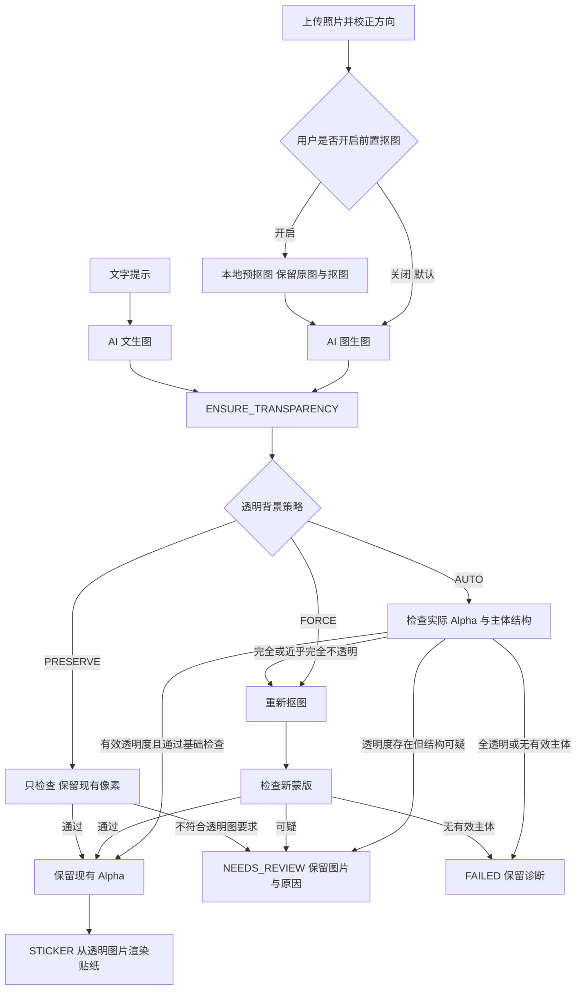

# 透明背景与图片工作流设计

日期：2026-09-28。适用范围：单件平铺衣物、生成式 AI、本地分割与贴纸展示。

## 1. 目标与共识

- 前置抠图由用户选择，默认关闭。它可以减少背景干扰，也可能误删袖口、衣领或衣物细节，因此不能强制执行。
- 生成模型的 PNG 输出不一定包含真正透明背景；有 Alpha 通道也不一定存在有效透明区域。判断依据是实际解码像素，不能依赖模型名、文件后缀或提示词承诺。
- 后置步骤的职责是“确保得到可用透明图”：保留现有 Alpha、执行本地抠图，或停止并提示人工检查。
- 原始校正照片、预抠图、生成图片、后处理图片分别保留，不覆盖，不将生成前的蒙版直接应用于生成后的图片。
- 透明度检查只验证结构和格式，不证明衣物保真、背景全部清除或衣物完整。AI 结果始终需要用户对照。

## 2. 工作流图（Mermaid）



FORCE 也不尝试从全透明图中恢复衣物；无可用输入时直接失败。NEEDS_REVIEW 是当前任务的终态，剩余步骤 SKIPPED，不自动生图或再次抠图。

## 3. 输入与前置抠图

测试页通过复选框控制前置抠图，默认不选。勾选后在 IMAGE_TO_IMAGE 之前插入 SEGMENT；API 也可直接编辑 steps。模型输入继续使用前一步图片。

生成服务保留输入 PNG 的 Alpha。若某服务商不支持透明参考图，后续可在发送副本上合成简单底色，不改本地透明原件。本版不自动增加铺底步骤，也不假设所有服务商接受透明输入。

工作流上传与旋转需保留已有透明度：先 EXIF 校正，再用户角度修正，透明图扩展画布保持透明。原有分割接口仍使用白底 RGB 作为分割模型输入，行为保持兼容。

## 4. 后置透明度检查

### 4.1 分类与策略

| 分类 | 含义 | AUTO | PRESERVE | FORCE |
| --- | --- | --- | --- | --- |
| USABLE | 有外部透明背景，且通过基础结构检查 | 原样沿用 | 原样沿用 | 重新抠图并检查 |
| OPAQUE | 无有效透明背景 | 本地抠图并检查 | NEEDS_REVIEW | 本地抠图并检查 |
| SUSPICIOUS | 已有透明度，但主体/背景结构可疑 | NEEDS_REVIEW | NEEDS_REVIEW | 本地抠图并检查 |
| EMPTY | 无有效主体 | FAILED | FAILED | FAILED |

检测在解码后的 Alpha 上执行，支持 PNG tRNS 解码得到的透明度。棋盘格或纯白背景若实际像素不透明，统一归入 OPAQUE，不依赖 RGB 图案识别。

### 4.2 第一版可解释规则

规则统一集中在 `TransparencyInspector`，属于针对单件衣物的启发式阈值，不是模型置信度：

- Alpha ≤ 7 视为透明，≥ 248 视为不透明；中间值统计为半透明，不修改像素。
- 没有 Alpha > 7 的像素，或没有任何 Alpha ≥ 128 的像素：EMPTY。本版不自动接受几乎不可见的图。
- 透明比例 < 0.5% 且半透明比例 < 0.5%：OPAQUE。
- 统计与画布四边连通的透明区域，占整张图不足 1%：SUSPICIOUS。
- Alpha ≥ 128 的前景占比 < 1% 或 > 90%：SUSPICIOUS。
- 可见前景触及画布任一边：SUSPICIOUS，提示可能截边，不直接宣称衣物被裁切。
- 半透明像素占比 > 20%：SUSPICIOUS，薄纱等情况需人工确认。
- 主前景连通区域占所有前景不足 95%：SUSPICIOUS，保留独立区域，不擅自删除配件或衣物碎片。

前景采用 8 邻域、外部透明背景采用 4 邻域。EMPTY / OPAQUE 快速返回时，未计算的连通区域指标为 null。阈值与边界值有合成样例测试；所有比例记录原始计算值，报告只作显示舍入。阈值后续应依据真实样本校准。

透明边框包着白色矩形可能通过这些检查；白色衣物、蕾丝、孔洞、阴影等都不能仅靠结构规则可靠判定。通过检查不代表语义抠图正确。

## 5. 本地抠图与像素保护

- AUTO 需要生成蒙版时默认 U2Net；可显式选择 GRABCUT。
- OpenCV 可用于统计和分割，不采用“删除所有接近白色像素”作为默认策略。
- 复用已有 Alpha 时原样传递 PNG，不经过当前 RGB 分割解码入口，不修改半透明边缘或颜色。
- 强制抠图可能损失细节，由用户明确选择，不自动对可疑的透明图反复处理。
- 后置抠图失败或结果可疑时保留前一步与已产出的图片，并停止后续贴纸。

## 6. 接口与执行记录

```json
{
  "type": "ENSURE_TRANSPARENCY",
  "policy": "AUTO",
  "method": "U2NET"
}
```

默认图生图流程为 `GENERATE → ENSURE_TRANSPARENCY → STICKER`。开启预抠图后为 `SEGMENT → GENERATE → ENSURE_TRANSPARENCY → STICKER`。

每个 ENSURE_TRANSPARENCY 步骤记录 `transparency`：策略、动作、检查前后指标与原因。动作包括 REUSED_ALPHA、SEGMENTED、NEEDS_REVIEW、REJECTED。任务/步骤新增 NEEDS_REVIEW 状态，与执行故障 FAILED 区分。

STICKER 改为读取前一步透明图片，允许紧接 ENSURE_TRANSPARENCY 或兼容旧 SEGMENT；历史 CUTOUT 输入也可直接进入 STICKER。STICKER 自身执行相同结构检查，避免不透明底图被错误装饰为矩形贴纸。不要将前一次检查的通过结果跨越 GENERATE 复用。

现有 Step 的新 policy 字段及 StepResult 的新 transparency 字段均可空，旧任务仍可读取；旧流程仍可提交，但不满足透明质量规则的贴纸输入会转为 NEEDS_REVIEW。

## 7. 成本、恢复与人工检查

检查和本地抠图不调用远程模型。不增加自动付费重试，也不增加自动循环。已有 UUID 幂等、任务持久化、重启标记中断保持不变。

NEEDS_REVIEW 时展示原因、输入图与候选输出，剩余步骤不执行。本版没有从中断步骤直接恢复的接口；用户可下载候选图，再选择本地“透明检查 → 贴纸”流程并使用 FORCE 重新提交，避免重跑已完成的付费生图步骤。

## 8. 验收

- 原生有效透明图原样通过，分割引擎调用数为零。
- 不透明图只执行一次本地分割；不依赖生成模型支持透明输出。
- 全透明、微小透明点、仅内部透明孔洞、主体触边、大面积半透明及多主体样例有确定分类与解释。
- 前置抠图关闭/开启的步骤顺序正确，默认关闭。
- PRESERVE 不执行分割，FORCE 显式执行；可疑结果停止贴纸。
- 透明上传与旋转不丢 Alpha；历史任务可读，旧本地分割功能回归通过。
- 使用已有生成图片进行真实本地流程验证，不额外调用付费服务。

参考：[PNG 规范](https://www.w3.org/TR/png-3/)、[OpenCV 连通区域统计](https://docs.opencv.org/4.x/d3/dc0/group__imgproc__shape.html)。
